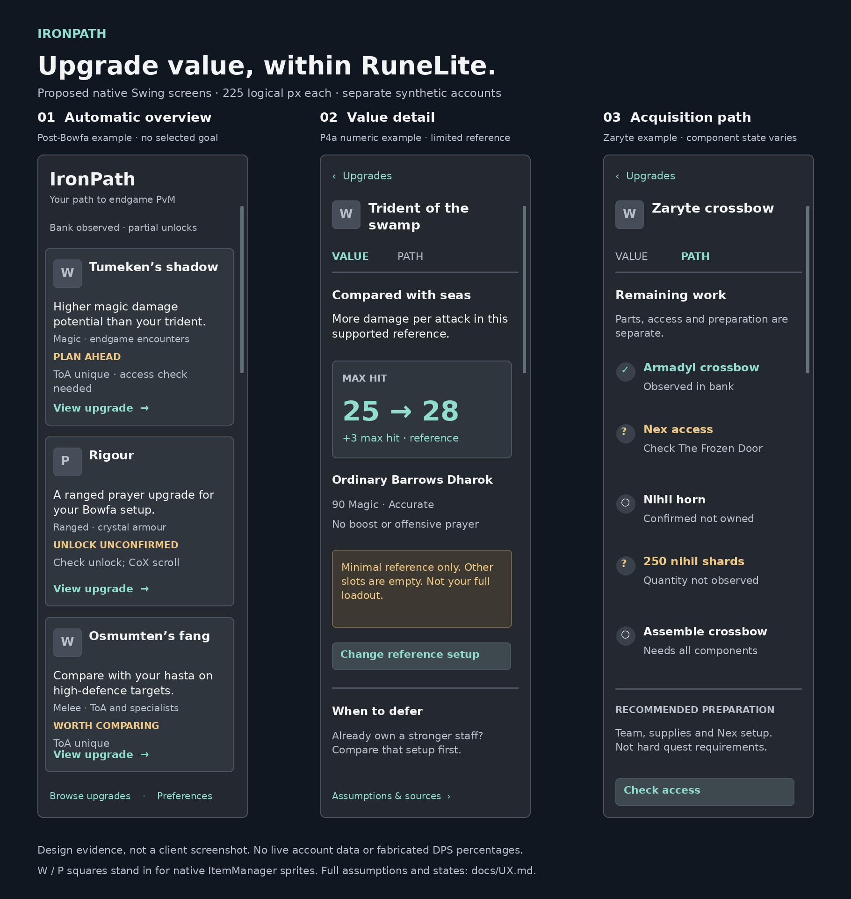

# Historical RuneLite UI direction

Historical specification, 12 October 2026, with R1 evidence added 13 October. Superseded by [UX.md](UX.md); retained as a design/history reference. The image is a **proposed wireframe**, not an implemented UI or live account screenshot. The three screens use separate synthetic examples. Only the stated 90-Magic trident max-hit example comes from P4a's recorded calculation; no invented improvement percentages are shown.

[Editable SVG](images/upgrade-advisor-wireframes.svg)

## R1 implementation evidence — 13 October 2026

The original wireframes above remain design references. R1 implements native overview cards, Value/Path navigation, before/after identity, supported metric rows, assumptions/source disclosures, focused slot/context corrections, compact prerequisite evidence, and Back with overview scroll restoration. The headless screenshots in [validation/R1.md](validation/R1.md) use real Swing controls at 225 pixels and synthetic accounts. ItemManager supplies sprites in the actual client; the captures use an accessible placeholder because no game client is connected.

Clipped Value/Path labels found in inspection were corrected and the screens recaptured. Overview, numerical detail, unsupported ToA detail, ordinary path, branching Magus recipe and Zaryte quantity path were inspected. Native client 100%, 125%, 150% and 200% scaling, sprite behavior and player usefulness are still pending; these captures do not pass R8. Full search/filter and comprehensive coverage remain later capabilities.

## Native implementation decision

Use the existing `PluginPanel`, Swing and `ItemManager` in the same client. Inspected RuneLite source declares `PANEL_WIDTH = 225`, a 17-pixel scrollbar allowance and 6-pixel border offsets; usable card content is narrower still. Design at that width first, then test RuneLite UI scaling and Windows display scaling. This is not a React/HTML/browser surface.

Use one column of cards with native item sprites and a clear visual hierarchy. A two-column grid is useful for a compact Browse icon grid only if names remain accessible; it is unsuitable for recommendation explanations at native width. Three primary recommendations plus Browse is a starting layout, not a maximum number of outcomes. Preserve scrolling position and filters when returning from details.

A custom wider sidebar or a user-opened modeless Swing detail dialog may be technically possible, but is not promised as Plugin Hub compatible. The current restrictions prohibit manipulating the client's window/focus and warn that existing plugins may be grandfathered. Build all core functions in the sidebar. Revisit a larger optional surface only after a genuine usability need and current policy/API verification. Do not introduce JavaFX, embedded browsers, external-process renderers or an account-export website.

References: [PluginPanel source](https://github.com/runelite/runelite/blob/master/runelite-client/src/main/java/net/runelite/client/ui/PluginPanel.java), [API](https://static.runelite.net/runelite-client/apidocs/net/runelite/client/ui/PluginPanel.html), [ItemManager](https://github.com/runelite/runelite/blob/master/runelite-client/src/main/java/net/runelite/client/game/ItemManager.java), [current restrictions](https://github.com/runelite/runelite/wiki/Rejected-or-Rolled-Back-Features).

## Overview

Header: **IronPath**, small tagline, Browse action. Beneath it, one unobtrusive account freshness line. No goal selector or checklist above recommendations. No giant “unknown” panel if useful conditional advice is already possible.

Card anatomy:

- 32×32 item sprite beside a wrapping bold item name. For a set, use its representative item and name the affected pieces in details. Wireframe squares are placeholders; production uses RuneLite's client image service with an accessible text fallback.
- A single strongest account-specific value statement. Supported numerical headline: “Max hit 25 → 28 · reference”. Qualitative headline: identify the actual role and baseline, not “good at many bosses”.
- One or two encounter labels; a longer list belongs in details.
- One concise status: Worth comparing, Plan ahead, Ownership unconfirmed, or Small gain. Status colour is supplementary to words.
- Remaining effort in plain language, and a clear Details action. Avoid acquisition promises from unknown access.

Show a few priorities immediately and a Browse list below, with optional style, slot, encounter, readiness and owned/deferred filters. Defaults must not hide long-term upgrades. Search may locate an item outside personalised recommendations; such a detail clearly says “Catalogue entry” rather than implying it was recommended. Research-only candidates belong in a separate coverage view, not as active upgrade cards.

Quick actions such as consuming a scroll or assembling owned parts form a small separate section. Account, preferences, source versions and diagnostics are secondary. Optional encounter interests can be chosen in Preferences or from a relevant card; no account-wide questionnaire.

## Upgrade details

Always retain a Back control and item identity. Use a compact view selector **Value | Path**. Sources and assumptions are disclosures within Value, not extra top-level tabs.

1. Lead with “Why for your account”: baseline item/package, useful role and the reason the recommendation outranks a weaker alternative.
2. Before/after item row. At narrow widths stack long equipment names. Explicitly remove incompatible off-hands or replace an entire package when needed.
3. Metric tiles: max hit, hit chance and theoretical DPS where individually supported. Absolute values before/after plus delta; no sparkline without meaningful data. Label target/context immediately next to results.
4. One-line scenario summary: observed levels, selected target and assumed prayer/boost. Expand to full inputs and model/source version; a player should not need to read raw formula/debug paragraphs to understand the result.
5. Relevant owned alternatives and a “When to defer” explanation, including no-breakpoint or sustain-versus-damage cases. Put acquisition effort near value, not above it.
6. Focused correction: “Change reference setup” edits a relevant slot/context, not a mandatory full calculator form. Unknown/missing input shows the exact reason and a useful remedy.

Calculated proposals are labelled reference scenarios. Confirmation does not turn a theoretical number into measured performance. Unsupported numbers show “Comparison not yet supported for …” while retaining justified qualitative value; no fake zeros or generic percentage.

## Acquisition path

Use a vertical sequence with compact ALL/ANY groups, not a large dependency tree squeezed sideways. Mark:

| Visual | Meaning |
|---|---|
| Check + Completed | Observed or explicitly confirmed completion, with provenance on expansion |
| Empty circle + Remaining | Confirmed unmet requirement/component |
| Question mark + Check needed | Unknown; never painted as failed or complete |
| “Recommended” label | Preparation; not a hard gate |
| “Alternative route” disclosure | ANY branch; alternatives remain selectable and don't require all branches |

Zaryte example: access section, Armadyl crossbow branch, nihil horn branch, shard quantity, assembly and equip level. Display complete steps without consuming the entire first screen. The next step is the nearest real missing prerequisite, or the most consequential unknown when no valid next activity is established. An already-owned horn changes remaining work; it never implies shards or readiness for Nex.

Do not show “70% complete” for RNG acquisition. An observed “120 / 250 shards” would be a component count with a timestamp, not a drop-probability gauge. Shared activity rewards have separate value rows. Keep optional focus/pin available without making it mandatory.

## Design tokens and behaviour

| Element | Proposed implementation |
|---|---|
| Surfaces | RuneLite `ColorScheme` dark backgrounds; card one shade apart with a subtle 1px boundary |
| Text | Client font, typically 12–13 logical pixels, 14–15 bold item titles; wrap by measured available width; respect scaling |
| Spacing | 6px outer panel inset, 8px card inset, 6–8px row gaps, 10–12px between cards |
| Accent | Muted teal for verified improvement, warm amber for conditional/plan-ahead; off-white primary text, readable secondary grey |
| Metrics | Larger tabular/aligned numbers where supported; labels always present; avoid red/green-only semantics |
| Navigation | `CardLayout` or equivalent view state within existing panel; Back, preserved list scroll, keyboard focus, Escape where appropriate |
| Controls | Standard Swing buttons/combos with accessible names, visible focus; full card click is additional, not the only action |
| Performance | Cache client sprites; calculate on immutable state outside render; update changed view data without rebuilding every control on a tick |
| Overflow | No horizontal scroll or clipped labels at native width; expand full explanations on demand |

The mockup colours are design intent, not a reason to replace all RuneLite conventions. Keep readable contrast at native scale. Image placeholders are not generated OSRS artwork and should not ship as item assets.

## Required interface states and checks

- No usable observation: explain what opening the bank will improve; allow Browse without pretending recommendations are personalised.
- Partial observation: useful provisional cards with targeted corrections; no ownership questionnaire.
- Strong alternatives or all supported outcomes owned: explain no meaningful supported gain, allow deferred/coverage browsing, never pad cards.
- Model unsupported: preserve a sensible card, identify the unsupported mechanic, keep the model gap visible to maintainers.
- Account/profile transition: clear cards/reference state; stale callback must not reopen previous-character details.
- Rescoring while a detail is open: preserve context if valid, otherwise show why it changed; no jarring navigation on every tick.

Render overview, numeric detail, qualitative specialist detail and a branching path at 225px; inspect 100%, 125%, 150% and 200% scaling in the actual client. Test long item names and screen-reader/accessibility labels. A player should find several useful choices quickly, describe why one matters, identify the baseline/assumptions and choose the next step without opening diagnostics. Record observed usability problems and fix them; mockup screenshots alone do not prove success.
