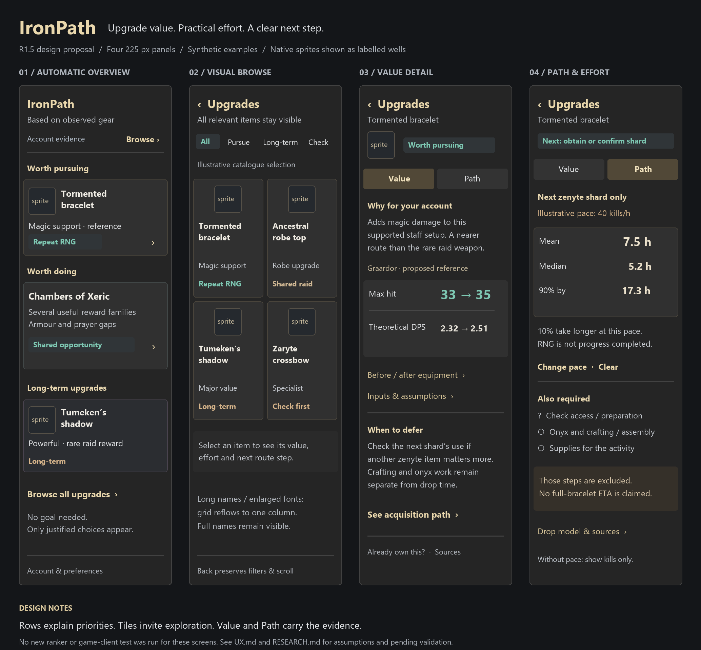

# IronPath native UI specification

13 October 2026 · **proposed R1.5 design, not implemented or live-client validated**. Keep native Swing/PluginPanel. [Earlier wireframes and R1 evidence](UX-20261012.md) remain historical references; [TASKS](../TASKS.md) is the sole delivery backlog.

[R1.5a implementation evidence](validation/R1.5a.md) now includes native component
captures of these surfaces, adaptive font/width checks and guarded controls.
The wireframes below remain design artifacts; actual RuneLite sprites/scaling and
player-usefulness checks remain pending.

[Editable SVG](images/r15/effort-wireframes.svg). Four independent synthetic states, each a 225-logical-pixel content panel. The labelled sprite wells are placeholders for native RuneLite sprites, not imported/generated OSRS artwork. The next-shard numbers are the explicitly illustrative 40-kills/hour scenario in RESEARCH; no real player pace is implied. The Value example uses R1's recorded synthetic tormented comparison, max hit 33→35 and DPS 2.32→2.51 on ordinary Graardor; it is not universal item value. Prototype text/category combinations illustrate the proposed decisions, not results of a new ranker run.

## Assessment and layout decision

Reviewed [R1 overview](images/r1/r1-overview.png) and [R1 Value](images/r1/r1-value.png). These are headless native Swing captures; the screenshot mentioned in the brief was not attached. Current problems are visible: repeated full-width action bars, long primary-card paragraphs, weak distinction between immediate work and rare-item aspirations, repeated metrics and prominent technical/account controls. R1 already calls ItemManager, so imagery is an integration/layout improvement rather than missing infrastructure.

**Choose a hybrid:** concise full-width rows for pursuits and shared activities, followed by a small long-term preview; Browse uses two columns where names and text fit. This gives the requested visual discovery without squeezing priority explanations into approximately 100 pixels. All items remain reachable; visible preview counts are not content limits. No mandatory goal or setup screen.

RuneLite's inspected PluginPanel prefers 225 content pixels and 6-pixel insets; its wrapper adds 17 for the scrollbar. Thus an ordinary 213-pixel content area with a 6-pixel gutter permits two approximately 103-pixel cards. Do not subtract the wrapper's scrollbar allowance again. Measure the actual viewport/insets in the client. [Pinned source](https://github.com/runelite/runelite/blob/5ac57c9d9dc3f47efc9d98d1cad25753e7c82f03/runelite-client/src/main/java/net/runelite/client/ui/PluginPanel.java).

**Implemented reference/metric follow-up (13 October 2026; client checks pending):** default compact summaries use **Enemy with 0 Defence**, with no Graardor or POH/dummy location label. Weapons lead with supported theoretical DPS and its delta; Value puts DPS before max hit and exposes attack interval and hit chance. Ordinary armour/jewellery with unchanged speed may lead with max hit; interval-changing effects use DPS first. If weapon DPS is unavailable, the main summary states the model gap and any supported max hit is secondary. Exact defensive/magic inputs stay in the assumptions disclosure. Boss-specific profiles are explicit contextual alternatives, not automatic defaults. Existing wireframes and R1/R1.5a captures below predate this request; implementation and client acceptance are tracked only in TASKS.

Two-column cards stack sprite, two/three-line name, one short value line and one effort/status line; never put a paragraph beside the sprite. Reflow the whole Browse grid to one column when effective cell width is under 100 logical pixels or actual font metrics cannot display the selected names/statuses without clipping. Permit taller rows where useful; never shrink the client font or rely on hover for a full name. Scaling is not just multiplying an exported image: test actual font metrics, OS DPI and client UI settings. A single-column layout toggle in Preferences is optional accessibility support, not a prerequisite.

## Overview and discovery

Header: IronPath, one line of context such as “Based on observed gear”; small **Browse** action. A quiet account-evidence link opens timestamps/unknowns. Knowledge versions, diagnostics and goals live behind Account/Preferences, below the main content. No repeated freshness/version block in details.

1. **Worth pursuing:** up to two concise rows, each a native sprite, full item name, one supported value headline and short effort/status. Use “Conditional”/“Check first” instead when ownership or access changes the conclusion. A title/chevron is the visible action; the row is also clickable. Do not show only a glowing high DPS number without a target/reference label.
2. **Worth doing:** one activity row, e.g. Chambers of Xeric with representative reward sprites and “Several useful rewards.” Activation opens its shared-reward view: useful families, owned/uncertain exclusions, route mode, any supported probabilities and a reason to continue/defer. It must explicitly distinguish “any useful reward” from obtaining all of them. This is an activity view inside the same panel, not a new main navigation tab.
3. **Long-term upgrades:** compact item preview and “Browse all.” Preserve discovery of Shadow/tbow/Scythe even when poor immediate grinds. If no near-term work exists, state that honestly and bring the remaining long-term/specialist choices into view without relabelling them efficient.
4. A compact quick-action section appears only for real assembly/claim/unlock opportunities. Account/Preferences follows the content. Avoid full-width administration buttons between recommendations.

Browse has **All / Pursue / Long-term / Check** category selection in R1.5a and a visible result count. Full search/style/slot/encounter filtering comes later in R6. Default All retains conditional/specialist/deferred relevant items. Owned outcomes can be inspected through a secondary toggle; owned is distinct from current usability. Research-only catalogue entries stay separate and cannot impersonate personalised recommendations. Keep category selection, scroll, selected item and keyboard focus when returning from detail.

### Card information budget

| Surface | Show | Put in detail |
|---|---|---|
| Pursuit row | Sprite; full name; one short value phrase; effort/status; compact chevron | Before/after setup, full metrics, prerequisites, sources and ownership controls |
| Browse tile | Sprite above full wrapping name; one concise value; one effort phrase with text status | Per-metric figures and comparison assumptions; do not cram all five axes into a badge |
| Activity row | Activity title; relevant reward sprites/names; why it offers several chances to improve | Reward family list, overlap/duplicates, points/mode/pace inputs and exclusions |
| No estimate | “Effort not estimated” or “Check requirements” | Missing mechanic/input and useful next action |

For qualitative cards use “Magic support,” “Special attack role” or another supported role; avoid generic “Huge upgrade.” For numerical headlines use one metric plus context, e.g. “+2 max hit · reference”; details identify the full setup/target. Do not display an hours badge unless the time scope is clear enough for that surface. “Long-term” is a recommendation category, not a drop probability.

## Value detail

Compact Back, item sprite/name, recommendation category, then **Value | Path**. No oversized repeated Open details control.

- Lead with why it matters **for this account**, relative to the strongest supported owned alternative. Include the active-priority/defer reason in plain language near the top.
- Show the selected context beside one before/after summary. Metric rows present supported max hit, hit chance and theoretical DPS once; unsupported metrics keep a precise gap. Max hit and accuracy are not interchangeable.
- Before/after equipment disclosure names removed off-hand/set changes. Input assumptions and model/source versions are expandable; changing reference setup remains a focused secondary action.
- “Consider first / When to defer” identifies a justified alternative and real opportunity cost. Do not add percentages from unrelated encounters or claim several items are guaranteed in the same hours.
- If ownership changes the advice, display one compact “Already own this?” correction link; open the existing guarded confirm/clear controls on demand. Never hide consequential uncertainty behind that link.
- Source links are available, but raw formula/debug text is not the first screen.

For a nearly complete account, specialist detail must name a concrete role and limits; it is acceptable to say “Small gain; pursue if this encounter matters to you.” Preferences remain optional. Supported scenarios do not certify raid skill or readiness.

## Path and effort detail

Lead with the next genuine remaining step, not a wall of requirements. Group Access, Components/assembly and Equip separately. Keep ALL/ANY vertical and collapsible; completed groups are compact. A tick means observed/confirmed completion, an empty circle means confirmed remaining, and a question mark means unknown. Colour is supplementary. Resource counts have observation time; an RNG drop has no completed-percent gauge.

Effort panel order:

1. Precise scope: **Next zenyte shard** (not “Tormented bracelet time”).
2. Without pace: mean 300 eligible kills, median 208, 90% by 690 under the reviewed fixed-drop model. State that 10% take longer.
3. Optional **Set pace** opens a compact eligible-kills/hour input with unit/scope explanation and Clear; default blank. If supplied, show conditional mean/median/P90 hours and the pace immediately beside them. No forced goal or performance questionnaire.
4. Explicit exclusions: quest/access, onyx, crafting/training and supply work are not included. Unknown remaining work forbids a full-item total. Fixed-rate dry KC does not imply progress toward the next drop.
5. Mechanic and pace provenance, review date and assumptions disclosure; show a separate pace sensitivity range when input is a range. Never call that a confidence interval or a maximum completion time.

Long-tail raid routes initially explain current mode/team/preparation and useful other rewards, with **Time not estimated** until the personal loot model and pacing are supported. A player can compare other routes and skip/restore an activity without erasing owned reward utility. An owned component bypasses its upstream acquisition; exact quantity unknown remains Check needed.

## Native components, appearance and interaction

| Concern | Implementation direction |
|---|---|
| Layout | Existing PluginPanel with BoxLayout/GridBagLayout rows, a nested GridLayout/adaptive grid, CardLayout for overview/activity/value/path; one vertical scroller, no horizontal scroll or nested scrolling cards |
| Sprites | Existing ItemManager `getImage(itemId).addTo(label/button)` asynchronous path; native sprite dimensions/aspect in a 40×40 well, no upscaled fake pixel art. Keep text fallback for unavailable images; no web downloads or bundled copied sprite pack |
| Surfaces | RuneLite ColorScheme dark surfaces, subtle 1px boundaries, restrained gold for titles, teal for pursuits, amber for uncertainty/long-term; text labels carry meaning |
| Type/spacing | Respect client font (roughly 12–13 logical pixels body, 14–15 title); 6px outer inset/gutters, 6–8px card padding. Measure strings, wrap, use accessible text contrast, never reduce font to force a tile |
| Activation | Standard Swing action semantics with visible focus; title/chevron plus clickable card. Enter/Space opens, Back restores focus/scroll. Tooltips supplement, never replace names/uncertainty. Avoid nested competing click targets |
| Rendering | Immutable view models, calculations outside rendering, EDT updates, reuse/caching for sprites. No per-tick complete rebuild or scroll jump; stale generation callbacks discarded |
| Scope | No JavaFX, browser framework, custom wider window, animated background or OS/window-focus manipulation. Original SVG/PNG documents are design artifacts, not a runtime UI framework |

Native ItemManager integration is the practical way to use real game sprites. This environment has no attached authenticated client from which to validate/capture them. Wireframes therefore use clearly labelled sprite wells; replace them with real client imagery during R1.5a verification rather than copying unlicensed web artwork into Git. [ItemManager reference](https://github.com/runelite/runelite/blob/5ac57c9d9dc3f47efc9d98d1cad25753e7c82f03/runelite-client/src/main/java/net/runelite/client/game/ItemManager.java).

## Required states and actual-client validation

Design states: empty/insufficient observation with useful bank guidance and Browse; partial/unknown with provisional value; all meaningful outcomes owned; only long-tail choices; unsupported numeric model; unknown pace; stale/invalid probability; skipped activity; shared rewards becoming owned; long names/enlarged font; profile/account transition while details or sprite loads are pending.

TASKS R1.5a contains the authoritative acceptance checks. Record actual RuneLite/OS versions, logical viewport, client/OS scaling combinations at 100%, 125%, 150% and 200%, font behaviour and screenshots. Inspect overview, grid and one-column fallback, Value, Path, activity detail, empty and unknown states. Check mouse/keyboard activation, visible focus, Back/scroll and generation guards. Ask the player to find a worthwhile next upgrade, explain its defer/effort reason, and identify a next step without diagnostics. Record findings, including disagreements, rather than treating a screenshot as a usefulness pass. All these **live checks remain pending** for this docs-only assignment.
