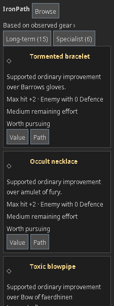
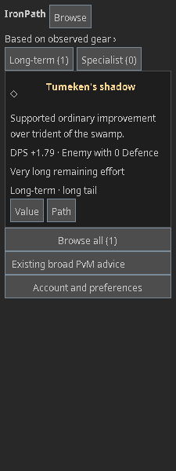
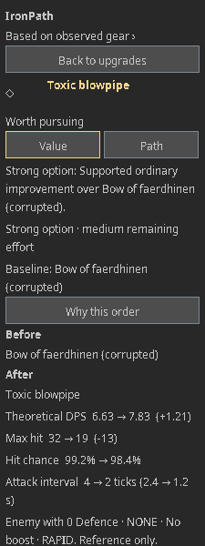
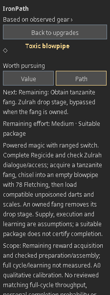
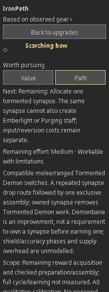
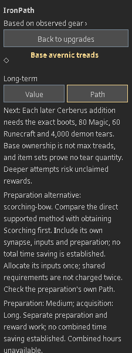
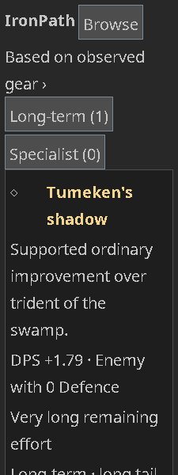

# EP1 — Account-efficient progression

14 October 2026 · implementation for review on main after planning PR #24 (`e3f02bc`) · plugin **0.10.0**, knowledge **ep1-1**, catalogue **12**, ranking **progression-2**, activity profiles **activity-effort-1**, unchanged preference schema **2**. Ordinary magic/ranged/melee formula versions are unchanged.

## Result and limits

All **29 active upgrade outcomes / 30 acquisition routes / 17 acquisition activity families** enter the same value, method suitability, remaining-effort and priority pipeline. The **44 active decisions**, including retained broad advice and local read/review/training actions, and **5 shared rewards** also use this policy. There are 25 active shared profiles; the separate Rosewood profile remains inactive research compatibility. No active route retains the importance-before-burden comparator. Counts describe this delivery, not a catalogue limit.

The first increment provides automatically selected **qualitative A0** profiles. Three next-reward models provide **A1** odds (zenyte for either bracelet or anguish, and synapse). A matching, optional, session-only manual pace can provide **A2** next-reward hours; Clear restores unavailable hours because **no automatic full-cycle numeric benchmark is promoted**. There is no A3 observation or A4 full-route distribution. A0 remains useful when numerical odds/time are unsupported or withdrawn.

Doom readiness uses reviewed main-ranged and demonbane-switch assumptions, with a distinct weaker workable profile. Levels and gear select a planning method; armour, demonbane spells, ammunition, supply renewal, execution and learning remain declared checks. No completion probability, personal speed or delve success is inferred. Scorching gets a reviewed qualitative Doom role and exclusive synapse route. Its ordinary/demonbane DPS remains unsupported: observing that owned family exposes a named strongest-owned ranged DPS gap while retaining supported reference max hit/hit chance. Captured worn-state KI1 offence remains separate.

## Policy calibration

These bands and cells are versioned product judgements, not measured hours or permanent item tiers. Short means a limited remaining assembly/claim/review action with its inputs checked. Medium describes the reviewed ordinary repeat route. Long covers substantial repeated acquisition, components or learning. Very long covers the reviewed exceptional rare/team burden or weaker Doom method. Material unknown preparation/resources remain conditional and never imply zero work. No fixed hour boundaries or global early/mid/endgame multiplier are used.

| Marginal account value | Short | Medium | Long | Very long | Unavailable |
|---|---|---|---|---|---|
| Key improvement | Strong next step | Strong next step | Worthwhile next step | Long horizon | Conditional |
| Strong option | Strong next step | Worthwhile next step | Later opportunity | Long horizon | Conditional |
| Contextual option | Worthwhile next step | Later opportunity | Long horizon | Long horizon | Conditional |
| Marginal / covered | Optional | Optional | Optional | Optional | Optional |
| Uncertain | Conditional | Conditional | Conditional | Conditional | Conditional |

Resolve hard access, consequential account uncertainty and method suitability before the table. Prepare-first/unknown methods and unresolved ownership/resources are conditional; demonstrated dominance is optional. Category/horizon is independent of priority. Long/very-long or long-tail outcomes keep Long-term labels even when they lead a nearly complete account.

Within a cell: explicit optional interest, claim-specific evidence, importance, effort, next-step readiness, compatible metric buckets, then stable outcome/route IDs. Ordinary numerical deltas only break ties inside compatible setup/context buckets. Retained local actions use the same table; level-target ties use their known target after value/effort, rather than assigning an XP/hour scenario. Shared activities use the best justified reward priority; counts, duplicated prose, equivalent contexts and utility cycles add no score.

PursuitOverview takes an ordered subsequence of the domain queue, retaining the first eligible representative of a correlated reward family. It performs no long-term/specialist insertion or importance re-sort. All eligible outcomes remain in Browse; Long-term/Specialist discovery remains visible. Card reflow and sprites do not rerank.

## Complete outcome × route × activity/method matrix

A0 bands below are the fresh-acquisition calibration before account checks, completed-component bypasses and method floors. The paired profile table supplies exact predicates, sources, assumptions and gaps. Every method is listed; unsupported account combinations produce a specific method check. A1 is next reward only; automatic A2/A3/A4 are unavailable on every row.

| Outcome | Route | Activity / mode | Profile method | A0 base / method floor | A1 |
|---|---|---|---|---|---|
| `occult-necklace` | `seek-occult-necklace` | smoke-devils / ordinary | `smoke-devils-effort` / `slayer` (suitable) | MEDIUM / SHORT | Unavailable |
| `swamp-trident` | `assemble-swamp-trident` | owned-magic / ordinary | `owned-magic-effort` / `assembly` (suitable) | SHORT / SHORT | Unavailable |
| `swamp-trident` | `seek-zulrah-magic-fang` | zulrah / ordinary | `zulrah-effort` / `mage-switch` (suitable) | MEDIUM / SHORT | Unavailable |
| `swamp-trident` | `seek-zulrah-magic-fang` | zulrah / ordinary | `zulrah-effort` / `mage-only` (workable) | MEDIUM / MEDIUM | Unavailable |
| `zaryte-crossbow` | `seek-zaryte-crossbow` | nex / ordinary | `nex-effort` / `team` (suitable) | VERY_LONG / SHORT | Unavailable |
| `avernic-treads` | `seek-avernic-treads` | doom / ordinary | `doom-effort` / `main` (suitable) | LONG / LONG | Unavailable |
| `avernic-treads` | `seek-avernic-treads` | doom / ordinary | `doom-effort` / `workable` (workable) | LONG / VERY_LONG | Unavailable |
| `tumekens-shadow` | `seek-tumekens-shadow` | toa / ordinary | `toa-effort` / `multi-style` (suitable) | VERY_LONG / LONG | Unavailable |
| `ancestral-hat` | `seek-ancestral-hat` | chambers-of-xeric / ordinary | `chambers-of-xeric-effort` / `team` (suitable) | LONG / LONG | Unavailable |
| `ancestral-robe-top` | `seek-ancestral-robe-top` | chambers-of-xeric / ordinary | `chambers-of-xeric-effort` / `team` (suitable) | LONG / LONG | Unavailable |
| `ancestral-robe-bottom` | `seek-ancestral-robe-bottom` | chambers-of-xeric / ordinary | `chambers-of-xeric-effort` / `team` (suitable) | LONG / LONG | Unavailable |
| `tormented-bracelet` | `seek-tormented-bracelet` | demonic-gorillas / ordinary | `demonic-gorillas-effort` / `switches` (suitable) | MEDIUM / SHORT | next-zenyte-shard |
| `magus-ring` | `seek-magus-ring` | duke-sucellus / ordinary | `duke-sucellus-effort` / `melee` (suitable) | LONG / SHORT | Unavailable |
| `twisted-bow` | `seek-twisted-bow` | chambers-of-xeric / ordinary | `chambers-of-xeric-effort` / `team` (suitable) | VERY_LONG / LONG | Unavailable |
| `bowfa` | `seek-bowfa` | cg / ordinary | `cg-effort` / `generated-gear` (suitable) | LONG / MEDIUM | Unavailable |
| `crystal-helm` | `seek-crystal-helm` | cg / ordinary | `cg-effort` / `generated-gear` (suitable) | MEDIUM / MEDIUM | Unavailable |
| `crystal-body` | `seek-crystal-body` | cg / ordinary | `cg-effort` / `generated-gear` (suitable) | MEDIUM / MEDIUM | Unavailable |
| `crystal-legs` | `seek-crystal-legs` | cg / ordinary | `cg-effort` / `generated-gear` (suitable) | MEDIUM / MEDIUM | Unavailable |
| `toxic-blowpipe` | `seek-toxic-blowpipe` | zulrah / ordinary | `zulrah-effort` / `mage-switch` (suitable) | MEDIUM / SHORT | Unavailable |
| `toxic-blowpipe` | `seek-toxic-blowpipe` | zulrah / ordinary | `zulrah-effort` / `mage-only` (workable) | MEDIUM / MEDIUM | Unavailable |
| `masori-mask` | `seek-masori-mask` | toa / ordinary | `toa-effort` / `multi-style` (suitable) | LONG / LONG | Unavailable |
| `masori-body` | `seek-masori-body` | toa / ordinary | `toa-effort` / `multi-style` (suitable) | LONG / LONG | Unavailable |
| `masori-chaps` | `seek-masori-chaps` | toa / ordinary | `toa-effort` / `multi-style` (suitable) | LONG / LONG | Unavailable |
| `necklace-of-anguish` | `seek-necklace-of-anguish` | demonic-gorillas / ordinary | `demonic-gorillas-effort` / `switches` (suitable) | MEDIUM / SHORT | next-anguish-zenyte |
| `necklace-of-rupture` | `seek-necklace-of-rupture` | maggot-king / ordinary | `maggot-king-effort` / `melee-range` (workable) | LONG / LONG | Unavailable |
| `dizanas-quiver` | `seek-dizanas-quiver` | colosseum / ordinary | `colosseum-effort` / `switches` (workable) | LONG / LONG | Unavailable |
| `venator-ring` | `seek-venator-ring` | leviathan / ordinary | `leviathan-effort` / `ranged` (suitable) | LONG / SHORT | Unavailable |
| `zaryte-vambraces` | `seek-zaryte-vambraces` | nex / ordinary | `nex-effort` / `team` (suitable) | VERY_LONG / SHORT | Unavailable |
| `twisted-buckler` | `seek-twisted-buckler` | chambers-of-xeric / ordinary | `chambers-of-xeric-effort` / `team` (suitable) | LONG / LONG | Unavailable |
| `avas-assembler` | `seek-avas-assembler` | vorkath / ordinary | `vorkath-effort` / `ranged` (suitable) | MEDIUM / SHORT | Unavailable |
| `venator-bow` | `seek-venator-bow` | muspah / ordinary | `muspah-effort` / `bowfa` (suitable) | LONG / SHORT | Unavailable |
| `venator-bow` | `seek-venator-bow` | muspah / ordinary | `muspah-effort` / `switch` (workable) | LONG / LONG | Unavailable |
| `abyssal-tentacle` | `seek-abyssal-tentacle` | slayer / ordinary-melee | `slayer-effort` / `tentacle` (suitable) | MEDIUM / MEDIUM | Unavailable |
| `scorching-bow` | `seek-scorching-bow` | tormented-demons / ordinary | `tormented-demons-effort` / `switches` (workable) | MEDIUM / MEDIUM | next-tormented-synapse |

## All retained secondary decisions and shared rewards

These rows are outside the upgrade-card outcomes but also have explicit contracts. Unavailable rows identify the missing mechanics/method/work; they do not bypass progression-2 or inherit an unexplained cheap default.

| Decision | Activity/profile | Band | Scope / specific gap |
|---|---|---|---|
| `unlock-rigour` | rigour-scroll / `rigour-scroll-effort` | SHORT | Known local read/review/planning action with finite remaining work. |
| `train-rigour` | prayer-training / `prayer-training-effort` | UNKNOWN | Prayer XP to 74, remaining bone/supply quantities and the training method are not reviewed together; unknown supply cost is not a short default. |
| `unlock-augury` | augury-scroll / `augury-scroll-effort` | SHORT | Known local read/review/planning action with finite remaining work. |
| `train-augury` | prayer-training / `prayer-training-effort` | UNKNOWN | Prayer XP to 77, remaining bone/supply quantities and the training method are not reviewed together; unknown supply cost is not a short default. |
| `plan-team-cox` | cox / `cox-effort` | SHORT | Known local read/review/planning action with finite remaining work. |
| `review-olm-lance` | owned-melee / `owned-melee-effort` | SHORT | Known local read/review/planning action with finite remaining work. |
| `coordinate-defence-reduction` | cox / `cox-effort` | SHORT | Known local read/review/planning action with finite remaining work. |
| `review-occult-switch` | owned-neck / `owned-neck-effort` | SHORT | Known local read/review/planning action with finite remaining work. |
| `pursue-bowfa` | cg / `cg-effort` | LONG | Reviewed repeated acquisition route with substantial remaining work. |
| `train-slayer-trident` | slayer / `slayer-effort` | UNKNOWN | Slayer XP to 87 depends on tasks, method, supplies and remaining training. A known level gap does not establish remaining grind time. |
| `seek-seas-trident` | slayer / `slayer-effort` | UNKNOWN | Kraken task supply, eligible recipient and remaining trident drop work are unreviewed. The tentacle/whip method profile does not establish this spell route; check the current task and casting supplies. |
| `seek-toa-fang` | toa / `toa-effort` | LONG | Reviewed repeated acquisition route with substantial remaining work. |
| `seek-moons-atlatl` | moons / `moons-effort` | UNKNOWN | Eclipse reward/chest eligibility, set-specific remaining pieces and duplicate protection are unmodelled. The retained Moons role evidence does not validate this account's full method/preparation effort. |
| `seek-titans-prayers` | royal-titans / `royal-titans-effort` | UNKNOWN | Personal Royal Titans reward attribution and an elemental spell/switch method are unreviewed. Powered-magic ownership does not establish fire-casting supplies or full-cycle pace. |

| Shared reward | Activity / profile | A0 base | Independent remaining-work handling |
|---|---|---|---|
| `cox-rigour` | chambers-of-xeric / `chambers-of-xeric-effort` | LONG | Owned unlock/scroll or sufficient scoped material removes this reward work; quantity/allocation and eligibility checks remain separate. No summed gains or shared completion probability. |
| `cox-augury` | chambers-of-xeric / `chambers-of-xeric-effort` | LONG | Owned unlock/scroll or sufficient scoped material removes this reward work; quantity/allocation and eligibility checks remain separate. No summed gains or shared completion probability. |
| `doom-cloth` | doom / `doom-effort` | LONG | Owned unlock/scroll or sufficient scoped material removes this reward work; quantity/allocation and eligibility checks remain separate. No summed gains or shared completion probability. |
| `doom-eye` | doom / `doom-effort` | LONG | Owned unlock/scroll or sufficient scoped material removes this reward work; quantity/allocation and eligibility checks remain separate. No summed gains or shared completion probability. |
| `muspah-heart-essence` | muspah / `muspah-effort` | LONG | Owned unlock/scroll or sufficient scoped material removes this reward work; quantity/allocation and eligibility checks remain separate. No summed gains or shared completion probability. |

## Complete profile and source register

Predicates use only supported observed usable forms, real levels and explicit facts. Positive manual ownership cannot establish a usable weapon or sufficient quantity. Missing gear observations do not select the weakest method. The thresholds are conservative planning calibration, not mandatory game access or claims about execution skill.

### owned-magic-effort

Remaining reward acquisition and checked preparation/assembly; full cycle/learning not measured. A0 qualitative calibration. No reviewed matching full-cycle throughput, personal completion probability or full-item hours.

- **assembly**: Owned-component assembly; suitable, floor SHORT. Predicate: local finite action. Supply, execution and learning are assumptions; a suitable package does not certify completion.

Evidence: [magic-fang](https://oldschool.runescape.wiki/w/Magic_fang?oldid=15299086), [swamp-trident](https://oldschool.runescape.wiki/w/Trident_of_the_swamp?oldid=15364128).

### zulrah-effort

Remaining reward acquisition and checked preparation/assembly; full cycle/learning not measured. A0 qualitative calibration. No reviewed matching full-cycle throughput, personal completion probability or full-item hours.

- **mage-switch**: Powered magic with ranged switch; suitable, floor SHORT. Predicate: ALL(MAGIC ≥ 75, RANGED ≥ 80, HITPOINTS ≥ 80, PRAYER ≥ 43, USABLE magic, USABLE ranged). Supply, execution and learning are assumptions; a suitable package does not certify completion.
- **mage-only**: Powered-magic-only planning method; workable, floor MEDIUM. Predicate: ALL(MAGIC ≥ 75, HITPOINTS ≥ 80, PRAYER ≥ 43, USABLE magic). Ranged phases and learning limit this method; food, prayer, travel and scales remain checks.

Evidence: [ayak](https://oldschool.runescape.wiki/w/Eye_of_ayak?oldid=15350914), [bowfa](https://oldschool.runescape.wiki/w/Bow_of_faerdhinen?oldid=15366535), [crossbow](https://oldschool.runescape.wiki/w/Rune_crossbow?oldid=15369406), [crystal-body](https://oldschool.runescape.wiki/w/Crystal_body?oldid=15369568), [crystal-helm](https://oldschool.runescape.wiki/w/Crystal_helm?oldid=15369569), [crystal-legs](https://oldschool.runescape.wiki/w/Crystal_legs?oldid=15369571), [ep1-zulrah-strategies](https://oldschool.runescape.wiki/w/Zulrah/Strategies?oldid=15356843), [item-ids](https://github.com/runelite/runelite/blob/42a6f17a6a2e8e478aa763890ecd0181a59dad38/runelite-api/src/main/java/net/runelite/api/gameval/ItemID.java), [sang](https://oldschool.runescape.wiki/w/Sanguinesti_staff?oldid=15336446), [sang-holy](https://oldschool.runescape.wiki/w/Holy_Sanguinesti_staff?oldid=15276380), [shadow](https://oldschool.runescape.wiki/w/Tumeken%27s_shadow?oldid=15316596), [swamp-e](https://oldschool.runescape.wiki/w/Trident_of_the_swamp_(e)?oldid=15317835), [swamp-trident](https://oldschool.runescape.wiki/w/Trident_of_the_swamp?oldid=15364128), [trident](https://oldschool.runescape.wiki/w/Trident_of_the_seas?oldid=15364129), [trident-e](https://oldschool.runescape.wiki/w/Trident_of_the_seas_(e)?oldid=15316738), [twisted-bow](https://oldschool.runescape.wiki/w/Twisted_bow?oldid=15363157).

### smoke-devils-effort

Remaining reward acquisition and checked preparation/assembly; full cycle/learning not measured. A0 qualitative calibration. No reviewed matching full-cycle throughput, personal completion probability or full-item hours.

- **slayer**: Supported magic / smoke-devil task; suitable, floor SHORT. Predicate: ALL(SLAYER ≥ 93, PRAYER ≥ 43, USABLE magic). Supply, execution and learning are assumptions; a suitable package does not certify completion.

Evidence: [ayak](https://oldschool.runescape.wiki/w/Eye_of_ayak?oldid=15350914), [ep1-smoke-devil](https://oldschool.runescape.wiki/w/Smoke_devil?oldid=15357607), [item-ids](https://github.com/runelite/runelite/blob/42a6f17a6a2e8e478aa763890ecd0181a59dad38/runelite-api/src/main/java/net/runelite/api/gameval/ItemID.java), [sang](https://oldschool.runescape.wiki/w/Sanguinesti_staff?oldid=15336446), [sang-holy](https://oldschool.runescape.wiki/w/Holy_Sanguinesti_staff?oldid=15276380), [shadow](https://oldschool.runescape.wiki/w/Tumeken%27s_shadow?oldid=15316596), [swamp-e](https://oldschool.runescape.wiki/w/Trident_of_the_swamp_(e)?oldid=15317835), [swamp-trident](https://oldschool.runescape.wiki/w/Trident_of_the_swamp?oldid=15364128), [trident](https://oldschool.runescape.wiki/w/Trident_of_the_seas?oldid=15364129), [trident-e](https://oldschool.runescape.wiki/w/Trident_of_the_seas_(e)?oldid=15316738).

### nex-effort

Remaining reward acquisition and checked preparation/assembly; full cycle/learning not measured. A0 qualitative calibration. No reviewed matching full-cycle throughput, personal completion probability or full-item hours.

- **team**: Reviewed team preparation with a crossbow role; suitable, floor SHORT. Predicate: ALL(FACT nex-team, RANGED ≥ 80, HITPOINTS ≥ 80, PRAYER ≥ 43, USABLE oneHandRanged). Supply, execution and learning are assumptions; a suitable package does not certify completion.

Evidence: [armadyl-crossbow](https://oldschool.runescape.wiki/w/Armadyl_crossbow?oldid=15364436), [crossbow](https://oldschool.runescape.wiki/w/Rune_crossbow?oldid=15369406), [ep1-nex-strategies](https://oldschool.runescape.wiki/w/Nex/Strategies?oldid=15356013), [item-ids](https://github.com/runelite/runelite/blob/42a6f17a6a2e8e478aa763890ecd0181a59dad38/runelite-api/src/main/java/net/runelite/api/gameval/ItemID.java), [r2-dragon-crossbow](https://oldschool.runescape.wiki/w/Dragon_crossbow?oldid=15352978), [r2-dragon-hunter-crossbow](https://oldschool.runescape.wiki/w/Dragon_hunter_crossbow?oldid=15188068), [zaryte](https://oldschool.runescape.wiki/w/Zaryte_crossbow?oldid=15293439).

### doom-effort

Remaining reward acquisition and checked preparation/assembly; full cycle/learning not measured. A0 qualitative calibration. No reviewed matching full-cycle throughput, personal completion probability or full-item hours.

- **main**: Scorching/twisted-bow main and demonbane switch; suitable, floor LONG. Predicate: ALL(FACT doom-preparation, RANGED ≥ 90, MAGIC ≥ 80, DEFENCE ≥ 80, PRAYER ≥ 43, ANY(USABLE scorchingBow, USABLE twistedBow), USABLE doomDarklight). Demonbane spell swap, suitable armour/arrows and supplies remain declared method assumptions; no delve success inferred.
- **workable**: Scorching main with lower reviewed planning levels; workable, floor VERY_LONG. Predicate: ALL(FACT doom-preparation, RANGED ≥ 77, MAGIC ≥ 80, DEFENCE ≥ 70, PRAYER ≥ 43, USABLE scorchingBow, USABLE doomDarklight). Lower planning levels increase preparation/learning burden; no fabricated speed multiplier. Demonbane magic and supplies remain checks.

Evidence: [ep1-doom-of-mokhaiotl-strategies](https://oldschool.runescape.wiki/w/Doom_of_Mokhaiotl/Strategies?oldid=15359842), [ep1-scorching-bow](https://oldschool.runescape.wiki/w/Scorching_bow?oldid=15317455), [ep1-the-doom-of-mokhaiotl](https://oldschool.runescape.wiki/w/Doom_of_Mokhaiotl?oldid=15360840), [item-ids](https://github.com/runelite/runelite/blob/42a6f17a6a2e8e478aa763890ecd0181a59dad38/runelite-api/src/main/java/net/runelite/api/gameval/ItemID.java), [twisted-bow](https://oldschool.runescape.wiki/w/Twisted_bow?oldid=15363157).

### toa-effort

Remaining reward acquisition and checked preparation/assembly; full cycle/learning not measured. A0 qualitative calibration. No reviewed matching full-cycle throughput, personal completion probability or full-item hours.

- **multi-style**: Reviewed multi-style raid preparation; suitable, floor LONG. Predicate: ALL(FACT toa-preparation, ALL(ATTACK ≥ 75, STRENGTH ≥ 75, RANGED ≥ 75, MAGIC ≥ 75, PRAYER ≥ 43, USABLE melee, USABLE ranged, USABLE magic)). Mode, scaling, team/solo, supplies and completion are assumptions; equipment does not establish raid pace.

Evidence: [ayak](https://oldschool.runescape.wiki/w/Eye_of_ayak?oldid=15350914), [bowfa](https://oldschool.runescape.wiki/w/Bow_of_faerdhinen?oldid=15366535), [crossbow](https://oldschool.runescape.wiki/w/Rune_crossbow?oldid=15369406), [crystal-body](https://oldschool.runescape.wiki/w/Crystal_body?oldid=15369568), [crystal-helm](https://oldschool.runescape.wiki/w/Crystal_helm?oldid=15369569), [crystal-legs](https://oldschool.runescape.wiki/w/Crystal_legs?oldid=15369571), [ep1-tombs-of-amascut-strategies](https://oldschool.runescape.wiki/w/Tombs_of_Amascut/Strategies?oldid=15371504), [fang](https://oldschool.runescape.wiki/w/Osmumten%27s_fang?oldid=15236139), [item-ids](https://github.com/runelite/runelite/blob/42a6f17a6a2e8e478aa763890ecd0181a59dad38/runelite-api/src/main/java/net/runelite/api/gameval/ItemID.java), [lance](https://oldschool.runescape.wiki/w/Dragon_hunter_lance?oldid=15264894), [sang](https://oldschool.runescape.wiki/w/Sanguinesti_staff?oldid=15336446), [sang-holy](https://oldschool.runescape.wiki/w/Holy_Sanguinesti_staff?oldid=15276380), [shadow](https://oldschool.runescape.wiki/w/Tumeken%27s_shadow?oldid=15316596), [swamp-e](https://oldschool.runescape.wiki/w/Trident_of_the_swamp_(e)?oldid=15317835), [swamp-trident](https://oldschool.runescape.wiki/w/Trident_of_the_swamp?oldid=15364128), [tentacle](https://oldschool.runescape.wiki/w/Abyssal_tentacle?oldid=15364127), [trident](https://oldschool.runescape.wiki/w/Trident_of_the_seas?oldid=15364129), [trident-e](https://oldschool.runescape.wiki/w/Trident_of_the_seas_(e)?oldid=15316738), [twisted-bow](https://oldschool.runescape.wiki/w/Twisted_bow?oldid=15363157), [whip](https://oldschool.runescape.wiki/w/Abyssal_whip?oldid=15326130).

### chambers-of-xeric-effort

Remaining reward acquisition and checked preparation/assembly; full cycle/learning not measured. A0 qualitative calibration. No reviewed matching full-cycle throughput, personal completion probability or full-item hours.

- **team**: Ordinary team multi-style preparation; suitable, floor LONG. Predicate: ALL(FACT cox-preparation, ALL(ATTACK ≥ 75, STRENGTH ≥ 75, RANGED ≥ 75, MAGIC ≥ 75, PRAYER ≥ 43, USABLE melee, USABLE ranged, USABLE magic)). Team roles, scouting, points, layout and supplies remain checks; no solo or raid pace inferred.

Evidence: [ayak](https://oldschool.runescape.wiki/w/Eye_of_ayak?oldid=15350914), [bowfa](https://oldschool.runescape.wiki/w/Bow_of_faerdhinen?oldid=15366535), [crossbow](https://oldschool.runescape.wiki/w/Rune_crossbow?oldid=15369406), [crystal-body](https://oldschool.runescape.wiki/w/Crystal_body?oldid=15369568), [crystal-helm](https://oldschool.runescape.wiki/w/Crystal_helm?oldid=15369569), [crystal-legs](https://oldschool.runescape.wiki/w/Crystal_legs?oldid=15369571), [ep1-chambers-of-xeric-strategies](https://oldschool.runescape.wiki/w/Chambers_of_Xeric/Strategies?oldid=15357585), [fang](https://oldschool.runescape.wiki/w/Osmumten%27s_fang?oldid=15236139), [item-ids](https://github.com/runelite/runelite/blob/42a6f17a6a2e8e478aa763890ecd0181a59dad38/runelite-api/src/main/java/net/runelite/api/gameval/ItemID.java), [lance](https://oldschool.runescape.wiki/w/Dragon_hunter_lance?oldid=15264894), [sang](https://oldschool.runescape.wiki/w/Sanguinesti_staff?oldid=15336446), [sang-holy](https://oldschool.runescape.wiki/w/Holy_Sanguinesti_staff?oldid=15276380), [shadow](https://oldschool.runescape.wiki/w/Tumeken%27s_shadow?oldid=15316596), [swamp-e](https://oldschool.runescape.wiki/w/Trident_of_the_swamp_(e)?oldid=15317835), [swamp-trident](https://oldschool.runescape.wiki/w/Trident_of_the_swamp?oldid=15364128), [tentacle](https://oldschool.runescape.wiki/w/Abyssal_tentacle?oldid=15364127), [trident](https://oldschool.runescape.wiki/w/Trident_of_the_seas?oldid=15364129), [trident-e](https://oldschool.runescape.wiki/w/Trident_of_the_seas_(e)?oldid=15316738), [twisted-bow](https://oldschool.runescape.wiki/w/Twisted_bow?oldid=15363157), [whip](https://oldschool.runescape.wiki/w/Abyssal_whip?oldid=15326130).

### demonic-gorillas-effort

Remaining reward acquisition and checked preparation/assembly; full cycle/learning not measured. A0 qualitative calibration. No reviewed matching full-cycle throughput, personal completion probability or full-item hours.

- **switches**: Compatible melee / ranged switches; suitable, floor SHORT. Predicate: ALL(ATTACK ≥ 75, STRENGTH ≥ 75, RANGED ≥ 75, PRAYER ≥ 43, USABLE melee, USABLE ranged). Supply, execution and learning are assumptions; a suitable package does not certify completion.

Evidence: [bowfa](https://oldschool.runescape.wiki/w/Bow_of_faerdhinen?oldid=15366535), [crossbow](https://oldschool.runescape.wiki/w/Rune_crossbow?oldid=15369406), [crystal-body](https://oldschool.runescape.wiki/w/Crystal_body?oldid=15369568), [crystal-helm](https://oldschool.runescape.wiki/w/Crystal_helm?oldid=15369569), [crystal-legs](https://oldschool.runescape.wiki/w/Crystal_legs?oldid=15369571), [ep1-demonic-gorilla-strategies](https://oldschool.runescape.wiki/w/Demonic_gorilla/Strategies?oldid=15354866), [fang](https://oldschool.runescape.wiki/w/Osmumten%27s_fang?oldid=15236139), [item-ids](https://github.com/runelite/runelite/blob/42a6f17a6a2e8e478aa763890ecd0181a59dad38/runelite-api/src/main/java/net/runelite/api/gameval/ItemID.java), [lance](https://oldschool.runescape.wiki/w/Dragon_hunter_lance?oldid=15264894), [tentacle](https://oldschool.runescape.wiki/w/Abyssal_tentacle?oldid=15364127), [twisted-bow](https://oldschool.runescape.wiki/w/Twisted_bow?oldid=15363157), [whip](https://oldschool.runescape.wiki/w/Abyssal_whip?oldid=15326130).

### duke-sucellus-effort

Remaining reward acquisition and checked preparation/assembly; full cycle/learning not measured. A0 qualitative calibration. No reviewed matching full-cycle throughput, personal completion probability or full-item hours.

- **melee**: Ordinary melee Duke planning method; suitable, floor SHORT. Predicate: ALL(ATTACK ≥ 75, STRENGTH ≥ 75, PRAYER ≥ 43, USABLE melee). Supply, execution and learning are assumptions; a suitable package does not certify completion.

Evidence: [ep1-duke-sucellus](https://oldschool.runescape.wiki/w/Duke_Sucellus?oldid=15365802), [fang](https://oldschool.runescape.wiki/w/Osmumten%27s_fang?oldid=15236139), [item-ids](https://github.com/runelite/runelite/blob/42a6f17a6a2e8e478aa763890ecd0181a59dad38/runelite-api/src/main/java/net/runelite/api/gameval/ItemID.java), [lance](https://oldschool.runescape.wiki/w/Dragon_hunter_lance?oldid=15264894), [tentacle](https://oldschool.runescape.wiki/w/Abyssal_tentacle?oldid=15364127), [whip](https://oldschool.runescape.wiki/w/Abyssal_whip?oldid=15326130).

### cg-effort

Remaining reward acquisition and checked preparation/assembly; full cycle/learning not measured. A0 qualitative calibration. No reviewed matching full-cycle throughput, personal completion probability or full-item hours.

- **generated-gear**: Gauntlet-generated compatible equipment; suitable, floor MEDIUM. Predicate: ALL(MAGIC ≥ 80, RANGED ≥ 80, PRAYER ≥ 43). Outside equipment is not used. Preparation, learning, completions and shards are not inferred from bank gear.

Evidence: [ep1-corrupted-gauntlet](https://oldschool.runescape.wiki/w/The_Gauntlet?oldid=15367929).

### maggot-king-effort

Remaining reward acquisition and checked preparation/assembly; full cycle/learning not measured. A0 qualitative calibration. No reviewed matching full-cycle throughput, personal completion probability or full-item hours.

- **melee-range**: Melee damage with a ranged larvae switch; workable, floor LONG. Predicate: ALL(ATTACK ≥ 75, STRENGTH ≥ 75, RANGED ≥ 75, PRAYER ≥ 43, USABLE melee, USABLE ranged). Target-specific crush/heavy-ranged alternatives and survival remain checks; no full encounter model.

Evidence: [bowfa](https://oldschool.runescape.wiki/w/Bow_of_faerdhinen?oldid=15366535), [crossbow](https://oldschool.runescape.wiki/w/Rune_crossbow?oldid=15369406), [crystal-body](https://oldschool.runescape.wiki/w/Crystal_body?oldid=15369568), [crystal-helm](https://oldschool.runescape.wiki/w/Crystal_helm?oldid=15369569), [crystal-legs](https://oldschool.runescape.wiki/w/Crystal_legs?oldid=15369571), [ep1-maggot-king-strategies](https://oldschool.runescape.wiki/w/Maggot_King/Strategies?oldid=15369482), [fang](https://oldschool.runescape.wiki/w/Osmumten%27s_fang?oldid=15236139), [item-ids](https://github.com/runelite/runelite/blob/42a6f17a6a2e8e478aa763890ecd0181a59dad38/runelite-api/src/main/java/net/runelite/api/gameval/ItemID.java), [lance](https://oldschool.runescape.wiki/w/Dragon_hunter_lance?oldid=15264894), [tentacle](https://oldschool.runescape.wiki/w/Abyssal_tentacle?oldid=15364127), [twisted-bow](https://oldschool.runescape.wiki/w/Twisted_bow?oldid=15363157), [whip](https://oldschool.runescape.wiki/w/Abyssal_whip?oldid=15326130).

### colosseum-effort

Remaining reward acquisition and checked preparation/assembly; full cycle/learning not measured. A0 qualitative calibration. No reviewed matching full-cycle throughput, personal completion probability or full-item hours.

- **switches**: Reviewed multi-style Colosseum preparation; workable, floor LONG. Predicate: ALL(FACT colosseum-preparation, ALL(ATTACK ≥ 75, STRENGTH ≥ 75, RANGED ≥ 75, MAGIC ≥ 75, PRAYER ≥ 43, USABLE melee, USABLE ranged, USABLE magic)). Learning/failures and Sol method remain unquantified; Venator and premium weapons are optional.

Evidence: [ayak](https://oldschool.runescape.wiki/w/Eye_of_ayak?oldid=15350914), [bowfa](https://oldschool.runescape.wiki/w/Bow_of_faerdhinen?oldid=15366535), [crossbow](https://oldschool.runescape.wiki/w/Rune_crossbow?oldid=15369406), [crystal-body](https://oldschool.runescape.wiki/w/Crystal_body?oldid=15369568), [crystal-helm](https://oldschool.runescape.wiki/w/Crystal_helm?oldid=15369569), [crystal-legs](https://oldschool.runescape.wiki/w/Crystal_legs?oldid=15369571), [ep1-fortis-colosseum-strategies](https://oldschool.runescape.wiki/w/Fortis_Colosseum/Strategies?oldid=15370386), [fang](https://oldschool.runescape.wiki/w/Osmumten%27s_fang?oldid=15236139), [item-ids](https://github.com/runelite/runelite/blob/42a6f17a6a2e8e478aa763890ecd0181a59dad38/runelite-api/src/main/java/net/runelite/api/gameval/ItemID.java), [lance](https://oldschool.runescape.wiki/w/Dragon_hunter_lance?oldid=15264894), [sang](https://oldschool.runescape.wiki/w/Sanguinesti_staff?oldid=15336446), [sang-holy](https://oldschool.runescape.wiki/w/Holy_Sanguinesti_staff?oldid=15276380), [shadow](https://oldschool.runescape.wiki/w/Tumeken%27s_shadow?oldid=15316596), [swamp-e](https://oldschool.runescape.wiki/w/Trident_of_the_swamp_(e)?oldid=15317835), [swamp-trident](https://oldschool.runescape.wiki/w/Trident_of_the_swamp?oldid=15364128), [tentacle](https://oldschool.runescape.wiki/w/Abyssal_tentacle?oldid=15364127), [trident](https://oldschool.runescape.wiki/w/Trident_of_the_seas?oldid=15364129), [trident-e](https://oldschool.runescape.wiki/w/Trident_of_the_seas_(e)?oldid=15316738), [twisted-bow](https://oldschool.runescape.wiki/w/Twisted_bow?oldid=15363157), [whip](https://oldschool.runescape.wiki/w/Abyssal_whip?oldid=15326130).

### leviathan-effort

Remaining reward acquisition and checked preparation/assembly; full cycle/learning not measured. A0 qualitative calibration. No reviewed matching full-cycle throughput, personal completion probability or full-item hours.

- **ranged**: Supported ranged Leviathan package; suitable, floor SHORT. Predicate: ALL(RANGED ≥ 80, PRAYER ≥ 43, USABLE ranged). Supply, execution and learning are assumptions; a suitable package does not certify completion.

Evidence: [bowfa](https://oldschool.runescape.wiki/w/Bow_of_faerdhinen?oldid=15366535), [crossbow](https://oldschool.runescape.wiki/w/Rune_crossbow?oldid=15369406), [crystal-body](https://oldschool.runescape.wiki/w/Crystal_body?oldid=15369568), [crystal-helm](https://oldschool.runescape.wiki/w/Crystal_helm?oldid=15369569), [crystal-legs](https://oldschool.runescape.wiki/w/Crystal_legs?oldid=15369571), [ep1-the-leviathan](https://oldschool.runescape.wiki/w/The_Leviathan?oldid=15356627), [item-ids](https://github.com/runelite/runelite/blob/42a6f17a6a2e8e478aa763890ecd0181a59dad38/runelite-api/src/main/java/net/runelite/api/gameval/ItemID.java), [twisted-bow](https://oldschool.runescape.wiki/w/Twisted_bow?oldid=15363157).

### vorkath-effort

Remaining reward acquisition and checked preparation/assembly; full cycle/learning not measured. A0 qualitative calibration. No reviewed matching full-cycle throughput, personal completion probability or full-item hours.

- **ranged**: Supported ranged Vorkath planning package; suitable, floor SHORT. Predicate: ALL(RANGED ≥ 80, PRAYER ≥ 43, USABLE ranged). Supply, execution and learning are assumptions; a suitable package does not certify completion.

Evidence: [bowfa](https://oldschool.runescape.wiki/w/Bow_of_faerdhinen?oldid=15366535), [crossbow](https://oldschool.runescape.wiki/w/Rune_crossbow?oldid=15369406), [crystal-body](https://oldschool.runescape.wiki/w/Crystal_body?oldid=15369568), [crystal-helm](https://oldschool.runescape.wiki/w/Crystal_helm?oldid=15369569), [crystal-legs](https://oldschool.runescape.wiki/w/Crystal_legs?oldid=15369571), [ep1-vorkath](https://oldschool.runescape.wiki/w/Vorkath?oldid=15364808), [item-ids](https://github.com/runelite/runelite/blob/42a6f17a6a2e8e478aa763890ecd0181a59dad38/runelite-api/src/main/java/net/runelite/api/gameval/ItemID.java), [twisted-bow](https://oldschool.runescape.wiki/w/Twisted_bow?oldid=15363157).

### muspah-effort

Remaining reward acquisition and checked preparation/assembly; full cycle/learning not measured. A0 qualitative calibration. No reviewed matching full-cycle throughput, personal completion probability or full-item hours.

- **bowfa**: Bowfa/crystal Muspah method; suitable, floor SHORT. Predicate: ALL(FACT muspah-preparation, RANGED ≥ 80, PRAYER ≥ 43, USABLE bowfaOwned). Supply, execution and learning are assumptions; a suitable package does not certify completion.
- **switch**: Magic/ranged switch method; workable, floor LONG. Predicate: ALL(FACT muspah-preparation, RANGED ≥ 80, MAGIC ≥ 75, PRAYER ≥ 43, USABLE magic, USABLE ranged). Switches, smite-phase bolts, food and travel remain assumptions; no throughput or completed-bow time claimed.

Evidence: [ayak](https://oldschool.runescape.wiki/w/Eye_of_ayak?oldid=15350914), [bowfa](https://oldschool.runescape.wiki/w/Bow_of_faerdhinen?oldid=15366535), [bowfa-route](https://oldschool.runescape.wiki/w/Bow_of_faerdhinen?oldid=15366535), [crossbow](https://oldschool.runescape.wiki/w/Rune_crossbow?oldid=15369406), [crystal-body](https://oldschool.runescape.wiki/w/Crystal_body?oldid=15369568), [crystal-helm](https://oldschool.runescape.wiki/w/Crystal_helm?oldid=15369569), [crystal-legs](https://oldschool.runescape.wiki/w/Crystal_legs?oldid=15369571), [ep1-phantom-muspah-strategies](https://oldschool.runescape.wiki/w/Phantom_Muspah/Strategies?oldid=15371265), [item-ids](https://github.com/runelite/runelite/blob/42a6f17a6a2e8e478aa763890ecd0181a59dad38/runelite-api/src/main/java/net/runelite/api/gameval/ItemID.java), [sang](https://oldschool.runescape.wiki/w/Sanguinesti_staff?oldid=15336446), [sang-holy](https://oldschool.runescape.wiki/w/Holy_Sanguinesti_staff?oldid=15276380), [shadow](https://oldschool.runescape.wiki/w/Tumeken%27s_shadow?oldid=15316596), [swamp-e](https://oldschool.runescape.wiki/w/Trident_of_the_swamp_(e)?oldid=15317835), [swamp-trident](https://oldschool.runescape.wiki/w/Trident_of_the_swamp?oldid=15364128), [trident](https://oldschool.runescape.wiki/w/Trident_of_the_seas?oldid=15364129), [trident-e](https://oldschool.runescape.wiki/w/Trident_of_the_seas_(e)?oldid=15316738), [twisted-bow](https://oldschool.runescape.wiki/w/Twisted_bow?oldid=15363157).

### slayer-effort

Remaining reward acquisition and checked preparation/assembly; full cycle/learning not measured. A0 qualitative calibration. No reviewed matching full-cycle throughput, personal completion probability or full-item hours.

- **tentacle**: Whip and Kraken acquisition roles; suitable, floor MEDIUM. Predicate: ALL(SLAYER ≥ 87, MAGIC ≥ 50, USABLE magic, USABLE melee). Task supply, 85-Slayer whip work and irreversible whip consumption remain separate.

Evidence: [ayak](https://oldschool.runescape.wiki/w/Eye_of_ayak?oldid=15350914), [ep1-kraken-tentacle](https://oldschool.runescape.wiki/w/Kraken_tentacle?oldid=15316741), [fang](https://oldschool.runescape.wiki/w/Osmumten%27s_fang?oldid=15236139), [item-ids](https://github.com/runelite/runelite/blob/42a6f17a6a2e8e478aa763890ecd0181a59dad38/runelite-api/src/main/java/net/runelite/api/gameval/ItemID.java), [lance](https://oldschool.runescape.wiki/w/Dragon_hunter_lance?oldid=15264894), [sang](https://oldschool.runescape.wiki/w/Sanguinesti_staff?oldid=15336446), [sang-holy](https://oldschool.runescape.wiki/w/Holy_Sanguinesti_staff?oldid=15276380), [shadow](https://oldschool.runescape.wiki/w/Tumeken%27s_shadow?oldid=15316596), [swamp-e](https://oldschool.runescape.wiki/w/Trident_of_the_swamp_(e)?oldid=15317835), [swamp-trident](https://oldschool.runescape.wiki/w/Trident_of_the_swamp?oldid=15364128), [tentacle](https://oldschool.runescape.wiki/w/Abyssal_tentacle?oldid=15364127), [trident](https://oldschool.runescape.wiki/w/Trident_of_the_seas?oldid=15364129), [trident-e](https://oldschool.runescape.wiki/w/Trident_of_the_seas_(e)?oldid=15316738), [whip](https://oldschool.runescape.wiki/w/Abyssal_whip?oldid=15326130).

### tormented-demons-effort

Remaining reward acquisition and checked preparation/assembly; full cycle/learning not measured. A0 qualitative calibration. No reviewed matching full-cycle throughput, personal completion probability or full-item hours.

- **switches**: Compatible melee/ranged Tormented Demon switches; workable, floor MEDIUM. Predicate: ALL(ATTACK ≥ 75, STRENGTH ≥ 75, RANGED ≥ 75, PRAYER ≥ 43, USABLE melee, USABLE ranged). Demonbane is an improvement, not a requirement to own a synapse before earning one; shield/accuracy phases and supply overhead are unmodelled.

Evidence: [bowfa](https://oldschool.runescape.wiki/w/Bow_of_faerdhinen?oldid=15366535), [crossbow](https://oldschool.runescape.wiki/w/Rune_crossbow?oldid=15369406), [crystal-body](https://oldschool.runescape.wiki/w/Crystal_body?oldid=15369568), [crystal-helm](https://oldschool.runescape.wiki/w/Crystal_helm?oldid=15369569), [crystal-legs](https://oldschool.runescape.wiki/w/Crystal_legs?oldid=15369571), [ep1-tormented-demon](https://oldschool.runescape.wiki/w/Tormented_Demon?oldid=15337983), [ep1-tormented-demon-strategies](https://oldschool.runescape.wiki/w/Tormented_Demon/Strategies?oldid=15371090), [fang](https://oldschool.runescape.wiki/w/Osmumten%27s_fang?oldid=15236139), [item-ids](https://github.com/runelite/runelite/blob/42a6f17a6a2e8e478aa763890ecd0181a59dad38/runelite-api/src/main/java/net/runelite/api/gameval/ItemID.java), [lance](https://oldschool.runescape.wiki/w/Dragon_hunter_lance?oldid=15264894), [tentacle](https://oldschool.runescape.wiki/w/Abyssal_tentacle?oldid=15364127), [twisted-bow](https://oldschool.runescape.wiki/w/Twisted_bow?oldid=15363157), [whip](https://oldschool.runescape.wiki/w/Abyssal_whip?oldid=15326130).

### rosewood-crafting-effort

Inactive Rosewood compatibility only. Remaining reward acquisition and checked preparation/assembly; full cycle/learning not measured. A0 qualitative calibration. No reviewed matching full-cycle throughput, personal completion probability or full-item hours.

- **crafting**: Owned-material crafting; suitable, floor SHORT. Predicate: local finite action. Supply, execution and learning are assumptions; a suitable package does not certify completion.

Evidence: [r2-rosewood-blowpipe](https://oldschool.runescape.wiki/w/Rosewood_blowpipe?oldid=15357394).

### rigour-scroll-effort

Specified local action / reviewed planning step; acquisition and training totals not measured. A0 only. XP, resource supply, training method or completion pace unavailable for numerical time.

- **planning-step**: Reviewed local action / preparation check; suitable, floor SHORT. Predicate: local finite action. This is a planning step, not certification of the activity or a full acquisition estimate.

Evidence: [dex-scroll](https://oldschool.runescape.wiki/w/Dexterous_prayer_scroll?oldid=15188080), [item-ids](https://github.com/runelite/runelite/blob/42a6f17a6a2e8e478aa763890ecd0181a59dad38/runelite-api/src/main/java/net/runelite/api/gameval/ItemID.java), [rigour](https://oldschool.runescape.wiki/w/Rigour?oldid=14954629).

### prayer-training-effort

Specified local action / reviewed planning step; acquisition and training totals not measured. A0 only. XP, resource supply, training method or completion pace unavailable for numerical time.

- **planning-step**: Reviewed local action / preparation check; suitable, floor SHORT. Predicate: local finite action. This is a planning step, not certification of the activity or a full acquisition estimate.

Evidence: [rigour](https://oldschool.runescape.wiki/w/Rigour?oldid=14954629).

### augury-scroll-effort

Specified local action / reviewed planning step; acquisition and training totals not measured. A0 only. XP, resource supply, training method or completion pace unavailable for numerical time.

- **planning-step**: Reviewed local action / preparation check; suitable, floor SHORT. Predicate: local finite action. This is a planning step, not certification of the activity or a full acquisition estimate.

Evidence: [arcane-scroll](https://oldschool.runescape.wiki/w/Arcane_prayer_scroll?oldid=15188166), [augury](https://oldschool.runescape.wiki/w/Augury?oldid=15362822), [item-ids](https://github.com/runelite/runelite/blob/42a6f17a6a2e8e478aa763890ecd0181a59dad38/runelite-api/src/main/java/net/runelite/api/gameval/ItemID.java).

### cox-effort

Specified local action / reviewed planning step; acquisition and training totals not measured. A0 only. XP, resource supply, training method or completion pace unavailable for numerical time.

- **planning-step**: Reviewed local action / preparation check; suitable, floor SHORT. Predicate: local finite action. This is a planning step, not certification of the activity or a full acquisition estimate.

Evidence: [ayak](https://oldschool.runescape.wiki/w/Eye_of_ayak?oldid=15350914), [bowfa](https://oldschool.runescape.wiki/w/Bow_of_faerdhinen?oldid=15366535), [cox-kit](https://oldschool.runescape.wiki/w/Chambers_of_Xeric/Strategies?oldid=15357585), [crossbow](https://oldschool.runescape.wiki/w/Rune_crossbow?oldid=15369406), [crystal](https://oldschool.runescape.wiki/w/Crystal_equipment?oldid=15355197), [crystal-body](https://oldschool.runescape.wiki/w/Crystal_body?oldid=15369568), [crystal-helm](https://oldschool.runescape.wiki/w/Crystal_helm?oldid=15369569), [crystal-legs](https://oldschool.runescape.wiki/w/Crystal_legs?oldid=15369571), [fang](https://oldschool.runescape.wiki/w/Osmumten%27s_fang?oldid=15236139), [item-ids](https://github.com/runelite/runelite/blob/42a6f17a6a2e8e478aa763890ecd0181a59dad38/runelite-api/src/main/java/net/runelite/api/gameval/ItemID.java), [lance](https://oldschool.runescape.wiki/w/Dragon_hunter_lance?oldid=15264894), [sang](https://oldschool.runescape.wiki/w/Sanguinesti_staff?oldid=15336446), [sang-holy](https://oldschool.runescape.wiki/w/Holy_Sanguinesti_staff?oldid=15276380), [shadow](https://oldschool.runescape.wiki/w/Tumeken%27s_shadow?oldid=15316596), [swamp-e](https://oldschool.runescape.wiki/w/Trident_of_the_swamp_(e)?oldid=15317835), [swamp-trident](https://oldschool.runescape.wiki/w/Trident_of_the_swamp?oldid=15364128), [tentacle](https://oldschool.runescape.wiki/w/Abyssal_tentacle?oldid=15364127), [trident](https://oldschool.runescape.wiki/w/Trident_of_the_seas?oldid=15364129), [trident-e](https://oldschool.runescape.wiki/w/Trident_of_the_seas_(e)?oldid=15316738), [twisted-bow](https://oldschool.runescape.wiki/w/Twisted_bow?oldid=15363157), [whip](https://oldschool.runescape.wiki/w/Abyssal_whip?oldid=15326130).

### owned-melee-effort

Specified local action / reviewed planning step; acquisition and training totals not measured. A0 only. XP, resource supply, training method or completion pace unavailable for numerical time.

- **planning-step**: Reviewed local action / preparation check; suitable, floor SHORT. Predicate: local finite action. This is a planning step, not certification of the activity or a full acquisition estimate.

Evidence: [cox-kit](https://oldschool.runescape.wiki/w/Chambers_of_Xeric/Strategies?oldid=15357585), [fang](https://oldschool.runescape.wiki/w/Osmumten%27s_fang?oldid=15236139), [item-ids](https://github.com/runelite/runelite/blob/42a6f17a6a2e8e478aa763890ecd0181a59dad38/runelite-api/src/main/java/net/runelite/api/gameval/ItemID.java), [lance](https://oldschool.runescape.wiki/w/Dragon_hunter_lance?oldid=15264894), [scythe](https://oldschool.runescape.wiki/w/Scythe_of_Vitur?oldid=15365993), [soulreaper](https://oldschool.runescape.wiki/w/Soulreaper_axe?oldid=15360513), [tentacle](https://oldschool.runescape.wiki/w/Abyssal_tentacle?oldid=15364127), [whip](https://oldschool.runescape.wiki/w/Abyssal_whip?oldid=15326130).

### owned-neck-effort

Specified local action / reviewed planning step; acquisition and training totals not measured. A0 only. XP, resource supply, training method or completion pace unavailable for numerical time.

- **planning-step**: Reviewed local action / preparation check; suitable, floor SHORT. Predicate: local finite action. This is a planning step, not certification of the activity or a full acquisition estimate.

Evidence: [ayak](https://oldschool.runescape.wiki/w/Eye_of_ayak?oldid=15350914), [cox-kit](https://oldschool.runescape.wiki/w/Chambers_of_Xeric/Strategies?oldid=15357585), [fury](https://oldschool.runescape.wiki/w/Amulet_of_fury?oldid=15366576), [fury-or](https://oldschool.runescape.wiki/w/Amulet_of_fury_(or)?oldid=15361569), [item-ids](https://github.com/runelite/runelite/blob/42a6f17a6a2e8e478aa763890ecd0181a59dad38/runelite-api/src/main/java/net/runelite/api/gameval/ItemID.java), [occult](https://oldschool.runescape.wiki/w/Occult_necklace?oldid=15314514), [occult-or](https://oldschool.runescape.wiki/w/Occult_necklace_(or)?oldid=15187781), [sang](https://oldschool.runescape.wiki/w/Sanguinesti_staff?oldid=15336446), [sang-holy](https://oldschool.runescape.wiki/w/Holy_Sanguinesti_staff?oldid=15276380), [shadow](https://oldschool.runescape.wiki/w/Tumeken%27s_shadow?oldid=15316596), [swamp-e](https://oldschool.runescape.wiki/w/Trident_of_the_swamp_(e)?oldid=15317835), [swamp-trident](https://oldschool.runescape.wiki/w/Trident_of_the_swamp?oldid=15364128), [trident](https://oldschool.runescape.wiki/w/Trident_of_the_seas?oldid=15364129), [trident-e](https://oldschool.runescape.wiki/w/Trident_of_the_seas_(e)?oldid=15316738).

### moons-effort

Specified local action / reviewed planning step; acquisition and training totals not measured. A0 only. XP, resource supply, training method or completion pace unavailable for numerical time.

- **planning-step**: Reviewed local action / preparation check; suitable, floor SHORT. Predicate: local finite action. This is a planning step, not certification of the activity or a full acquisition estimate.

Evidence: [atlatl](https://oldschool.runescape.wiki/w/Eclipse_atlatl?oldid=15356407), [bowfa](https://oldschool.runescape.wiki/w/Bow_of_faerdhinen?oldid=15366535), [bowfa-route](https://oldschool.runescape.wiki/w/Bow_of_faerdhinen?oldid=15366535), [crossbow](https://oldschool.runescape.wiki/w/Rune_crossbow?oldid=15369406), [crystal-body](https://oldschool.runescape.wiki/w/Crystal_body?oldid=15369568), [crystal-helm](https://oldschool.runescape.wiki/w/Crystal_helm?oldid=15369569), [crystal-legs](https://oldschool.runescape.wiki/w/Crystal_legs?oldid=15369571), [fang](https://oldschool.runescape.wiki/w/Osmumten%27s_fang?oldid=15236139), [item-ids](https://github.com/runelite/runelite/blob/42a6f17a6a2e8e478aa763890ecd0181a59dad38/runelite-api/src/main/java/net/runelite/api/gameval/ItemID.java), [lance](https://oldschool.runescape.wiki/w/Dragon_hunter_lance?oldid=15264894), [moons-route](https://oldschool.runescape.wiki/w/Moons_of_Peril?oldid=15357442), [moons-strategy](https://oldschool.runescape.wiki/w/Moons_of_Peril/Strategies?oldid=15357348), [tentacle](https://oldschool.runescape.wiki/w/Abyssal_tentacle?oldid=15364127), [twisted-bow](https://oldschool.runescape.wiki/w/Twisted_bow?oldid=15363157), [whip](https://oldschool.runescape.wiki/w/Abyssal_whip?oldid=15326130).

### royal-titans-effort

Specified local action / reviewed planning step; acquisition and training totals not measured. A0 only. XP, resource supply, training method or completion pace unavailable for numerical time.

- **planning-step**: Reviewed local action / preparation check; suitable, floor SHORT. Predicate: local finite action. This is a planning step, not certification of the activity or a full acquisition estimate.

Evidence: [augury](https://oldschool.runescape.wiki/w/Augury?oldid=15362822), [bowfa](https://oldschool.runescape.wiki/w/Bow_of_faerdhinen?oldid=15366535), [crossbow](https://oldschool.runescape.wiki/w/Rune_crossbow?oldid=15369406), [crystal-body](https://oldschool.runescape.wiki/w/Crystal_body?oldid=15369568), [crystal-helm](https://oldschool.runescape.wiki/w/Crystal_helm?oldid=15369569), [crystal-legs](https://oldschool.runescape.wiki/w/Crystal_legs?oldid=15369571), [deadeye-route](https://oldschool.runescape.wiki/w/Deadeye?oldid=15222979), [deadeye-scroll-route](https://oldschool.runescape.wiki/w/Deadeye_prayer_scroll?oldid=15193033), [fang](https://oldschool.runescape.wiki/w/Osmumten%27s_fang?oldid=15236139), [item-ids](https://github.com/runelite/runelite/blob/42a6f17a6a2e8e478aa763890ecd0181a59dad38/runelite-api/src/main/java/net/runelite/api/gameval/ItemID.java), [lance](https://oldschool.runescape.wiki/w/Dragon_hunter_lance?oldid=15264894), [rigour](https://oldschool.runescape.wiki/w/Rigour?oldid=14954629), [tentacle](https://oldschool.runescape.wiki/w/Abyssal_tentacle?oldid=15364127), [titans-route](https://oldschool.runescape.wiki/w/Royal_Titans?oldid=15357424), [titans-strategy](https://oldschool.runescape.wiki/w/Royal_Titans/Strategies?oldid=15367754), [twisted-bow](https://oldschool.runescape.wiki/w/Twisted_bow?oldid=15363157), [vigour-route](https://oldschool.runescape.wiki/w/Mystic_Vigour?oldid=15335909), [vigour-scroll-route](https://oldschool.runescape.wiki/w/Mystic_vigour_prayer_scroll?oldid=15285526), [whip](https://oldschool.runescape.wiki/w/Abyssal_whip?oldid=15326130).

## Completed components, variants and preparation alternatives

The evaluator traverses the effective ALL/ANY path before removing work. An owned downstream intermediate can bypass its upstream acquisition; unknown intermediate ownership stays a check. Partial acquisition variants remove only their own stage: a horn does not remove the ACB route, and a vestige does not remove the seers-ring route. Remaining secondary routes lacking reviewed effort retain explicit unavailable bands. Equip requirements, skills, quantities and assembly survive completed acquisition. No component is simultaneously spent on competing outcomes.

| Route | Reviewed variant predicate | Remaining band | Work removed / retained |
|---|---|---|---|
| `seek-zaryte-crossbow` | ALL(POSSESSION nihilHorn, POSSESSION armadylCrossbow) | SHORT | Owned horn and ACB remove their acquisition stages; confirm 250 shards and 90 Fletching before bounded assembly. No total estimate. |
| `seek-zaryte-crossbow` | POSSESSION nihilHorn | UNKNOWN | Owned horn removes its Nex unique stage. ACB and shard acquisition/preparation are not quantified; check their remaining work before an active-pursuit claim. |
| `seek-tormented-bracelet` | POSSESSION zenyteBracelet | SHORT | Owned bracelet bypasses the shard, onyx and gem stages; only enchantment/equip checks remain. |
| `seek-tormented-bracelet` | ANY(POSSESSION zenyteGem, POSSESSION zenyteUncut) | SHORT | Owned gem/intermediate bypasses fresh gorilla acquisition; remaining skill/resources and assembly still need checking. |
| `seek-tormented-bracelet` | POSSESSION zenyteShard | SHORT | Owned shard removes its drop stage; onyx/crafting/assembly work is separate and may still be unknown. |
| `seek-magus-ring` | POSSESSION magusIcon | SHORT | Owned Magus icon removes Duke/vestige/seers work; remaining ingots, mould and skills determine readiness. |
| `seek-magus-ring` | ALL(POSSESSION magusVestige, ANY(POSSESSION seersIcon, POSSESSION seersRing)) | SHORT | Owned vestige and ring/icon remove their reward acquisition. Check remaining learning, skills, ingots and assembly; no fresh vestige grind or hidden-state estimate. |
| `seek-magus-ring` | POSSESSION magusVestige | UNKNOWN | Owned vestige removes its hidden-drop stage. The remaining seers ring/icon, ingots and assembly need their own checks; no total effort is claimed. |
| `seek-necklace-of-anguish` | POSSESSION zenyteNecklace | SHORT | Owned intermediate bypasses the acquisition stage; remaining resources/skills/assembly remain separate. |
| `seek-necklace-of-anguish` | ANY(POSSESSION zenyteUncut, POSSESSION zenyteGem) | SHORT | Owned uncut or cut zenyte bypasses fresh gorilla acquisition, onyx and fusion; remaining cutting, necklace crafting and enchantment checks still apply. |
| `seek-necklace-of-rupture` | POSSESSION etchedVenatorFang | SHORT | Owned intermediate bypasses the acquisition stage; remaining resources/skills/assembly remain separate. |
| `seek-venator-ring` | POSSESSION venatorIcon | SHORT | Owned intermediate bypasses the acquisition stage; remaining resources/skills/assembly remain separate. |
| `seek-abyssal-tentacle` | ALL(POSSESSION abyssalWhip, POSSESSION krakenTentacle) | SHORT | Both inputs owned; only irreversible assembly remains. Whip upkeep and competing trident enhancement remain choices. |

Confirmed acquisition-stage components also cover Bowfa/crystal quantities, tanzanite fang, Vorkath head, five Venator shards, synapse, zenyte and the tentacle inputs. Largest observed container count avoids duplicate moved-stack totals. Short describes the remaining assembly scope; an unknown ingot/shard quantity or training/access gap still prevents a confident active pursuit.

Doom exports the **direct route** and a **Scorching-first preparation alternative**. The latter includes the preparation's own synapse/inputs/levels/allocation and recomputes the conditional Doom method under that proposed item while retaining all other account checks. It does not mutate observed ownership. Preparation already owned incurs no repeat grind. Shared requirements are not added twice; mutually exclusive resources remain explicit. Neither total hours nor a time-saving/payback claim is available. The Scorching item retains its independent reviewed role.

## Numeric scope and review

Wiki revisions retrieved directly on 14 October include Tormented Demon **15337983**, synapse **15192516**, Scorching **15317455**, Doom strategies **15359842**, Zulrah strategies **15356843**, Muspah strategies **15371265**, Maggot King strategies **15369482**, ToA strategies **15371504**, CoX strategies **15357585** and Colosseum strategies **15370386**. Exact remaining dependencies and revisions are in the bundled register and profile links above. Only bounded mechanical facts and original explanations/calibration are bundled; guide prose, equipment tables, images and GPL calculator code are not copied.

Synapse: fixed 1/500 per eligible Tormented Demon kill (resolved before other unique loot); future mean 500, median/P90 from the existing independently authored geometric estimator. Zenyte: the retained 1/300 model now serves either jewellery route separately. These are **next component** distributions, not full-item ETAs. Past dry kills do not increase future odds. User scenario sensitivity is a range of conditional mean hours, not a confidence interval; quantiles are not added.

The [demonic gorilla benchmark review](https://oldschool.runescape.wiki/w/Money_making_guide/Killing_demonic_gorillas?oldid=15160575) supplies distinct Arclight/blowpipe and Emberlight/Scorching task/off-task assumptions, not validated throughput for the selected broad melee/ranged profile. Its supplied setup, task, potion and supply assumptions and full-cycle scope are not established by a generic bank observation. It is deliberately not an automatic pace preset. No guide record time, KI1 combat duration, raw DPS or gear-stage multiplier is converted into acquisition hours.

## Same-account before / after queues

Generated from EP1Fixtures against isolated baseline main **e3f02bc** and this implementation, with no goal or manual pace. These are anonymous synthetic fixtures; inputs are in the fixture source. The nearly-complete fixture also includes the new Scorching ID in the baseline input, so comparison inputs match. Scorching is newly promoted in the after catalogue.

| Account fixture | Before: first domain choices | Before: preview prefix | After: first domain choices | After: preview prefix |
|---|---|---|---|---|
| post-bowfa | tormented-bracelet, occult-necklace, toxic-blowpipe, necklace-of-rupture | tormented-bracelet, zaryte-crossbow, venator-bow, necklace-of-anguish | tormented-bracelet, occult-necklace, toxic-blowpipe, scorching-bow | tormented-bracelet, occult-necklace, toxic-blowpipe, scorching-bow |
| doom-workable | tormented-bracelet, occult-necklace, toxic-blowpipe, necklace-of-rupture | tormented-bracelet, zaryte-crossbow, venator-bow, necklace-of-anguish | tormented-bracelet, occult-necklace, abyssal-tentacle, necklace-of-rupture | tormented-bracelet, occult-necklace, abyssal-tentacle, necklace-of-rupture |
| doom-ready | tormented-bracelet, occult-necklace, toxic-blowpipe, necklace-of-rupture | tormented-bracelet, zaryte-crossbow, venator-bow, necklace-of-anguish | tormented-bracelet, occult-necklace, abyssal-tentacle, necklace-of-rupture | tormented-bracelet, occult-necklace, abyssal-tentacle, necklace-of-rupture |
| owned-components | necklace-of-anguish, tormented-bracelet, occult-necklace, toxic-blowpipe | necklace-of-anguish, ancestral-robe-top, zaryte-crossbow, toxic-blowpipe | necklace-of-anguish, tormented-bracelet, toxic-blowpipe, scorching-bow | necklace-of-anguish, tormented-bracelet, toxic-blowpipe, scorching-bow |
| early | abyssal-tentacle, avas-assembler, occult-necklace, tormented-bracelet | abyssal-tentacle, avas-assembler, occult-necklace, tormented-bracelet | abyssal-tentacle, magus-ring, ancestral-hat, ancestral-robe-bottom | abyssal-tentacle, magus-ring, ancestral-hat, avas-assembler |
| single-megarare | tormented-bracelet, occult-necklace, toxic-blowpipe, necklace-of-rupture | tormented-bracelet, zaryte-crossbow, venator-bow, necklace-of-anguish | tormented-bracelet, occult-necklace, toxic-blowpipe, necklace-of-rupture | tormented-bracelet, occult-necklace, toxic-blowpipe, necklace-of-rupture |
| nearly-complete | tumekens-shadow | tumekens-shadow | tumekens-shadow | tumekens-shadow |
| unread-bank | No eligible result | No eligible result | No eligible result | No eligible result |

The fresh post-Bowfa queue keeps several nearer substantial improvements before Shadow, and the preview no longer inserts Shadow above those choices. Owned parts remove only their own work. Doom-ready/workable profiles change effort without creating premium access requirements. An account with only Shadow remaining can honestly lead with a very-long result. Early/partial inputs produce specific preparation/observation checks rather than cheap or false-missing assumptions.

Full current queues and scoped estimates: [EP1 queues](EP1-queues.txt). Baseline domain queues and previews: [baseline queues](EP1-before-queues.txt). Reproduction: run the existing build with `JAVA_TOOL_OPTIONS=-Dironpath.ep1Evidence=true ./gradlew test build --no-daemon`; synthetic report files appear under build/validation/ep1.

## Validation and native evidence

Temurin 11.0.32.1 / Gradle 8.10 / RuneLite 1.13.1: `test build --no-daemon`. **298 tests, 0 failures, 0 errors, 0 skipped passed**. Existing oracle arithmetic, observation/profile/revision guards, preference migrations, navigation, pacing and recent-boss regressions are retained. New tests exercise the actual advisor pipeline, not just constructed ranker candidates. Superseded expectations are changed explicitly: forced preview insertion, importance-first local action ordering, reward-count activity promotion and fixed Venator horizon. Historical reports under their original versions are unchanged.

New evidence covers closer value versus very-long work; suitable/workable/prepare-first and unread inputs; partial and complete components/quantities; exclusive allocation; direct/preparation work; all-route/secondary/shared promotion contracts; optional scenario sensitivity/Clear; invalid odds retaining A0 value; owned unsupported family gaps; nearly-complete no-filler advice; stable preview order; and narrow native rendering/Back. Original permutation, prose/context alias and feedback regressions remain.

The following **225 × 600 Swing component captures use synthetic accounts and fallback/loading sprites**. They demonstrate integrated ordering/effort and navigation, not actual RuneLite sprites or player usefulness. They show the minimal EP1 integration; full UX2 styling/whole-card/comparison/account redesign remains pending.

| Post-Bowfa overview | Nearly complete |
|---|---|
|  |  |

| Blowpipe value | Blowpipe path |
|---|---|
|  |  |

| Synapse path | Doom preparation alternative |
|---|---|
|  |  |

Pending client checks: genuine sprites and scaling/font/focus/scroll at normal width; automatic WGS refresh and unknown Duradel-note knowledge; fresh bank and usable-form observations; profile/account/loading transitions; supplies/method suitability on representative players; and whether the calibrated ordering is useful. No client/player acceptance, automatic numeric profile, personal time, Q5 encounter/trip result or Plugin Hub approval is claimed.
