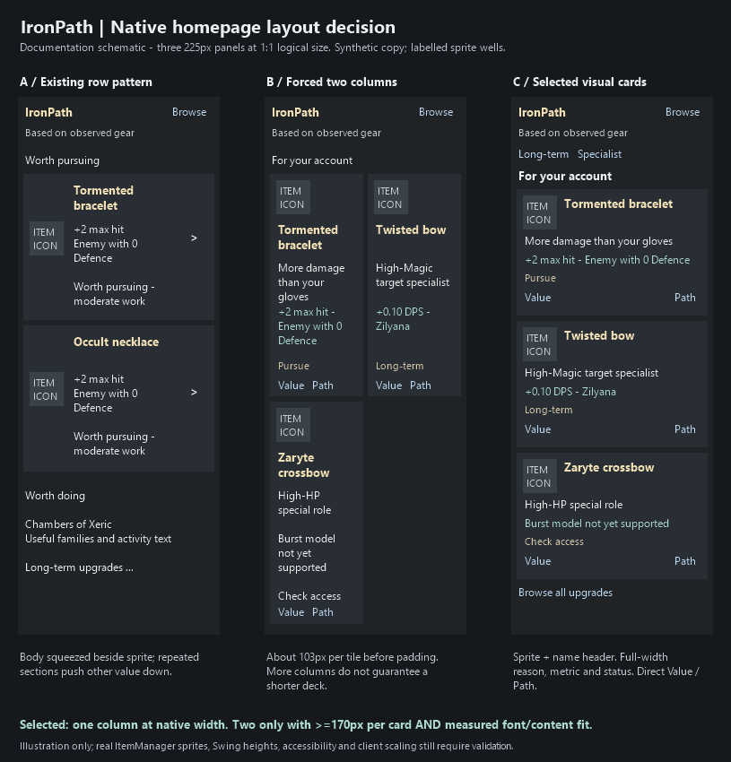

# R3a native UI direction review

13 October 2026. **Documentation/design only; no application implementation or new client/test pass.** Acceptance and the Codex implementation handoff live in [TASKS R3a](../../TASKS.md#r3--relationship-aware-advice-and-melee-packages), not a second backlog here.

## Inspected baseline

PR [#17](https://github.com/PetterHL/ironpath/pull/17), `docs/endgame-progression-intelligence`, head `71c8c17780f446ddc80615ccfc79a21e3aa49625`, base `r2-ranged-packages` at `32cb24a8db7ae807166d1f2d9844224c3be71fd6`. The branch already carries R2 source and its review corrections. No merge, application edit, runtime knowledge change or renewed PvM research was needed.

Read README, AGENTS, active TASKS, DESIGN progression/ranking contracts, CATALOGUE coverage boundaries, UX, R2/R1.5 validation and model-gap provenance. Inspected `IronpathPanel` rendering/navigation/text padding, `CompactRowLayout`, `BrowseGrid`, `PursuitOverview`, ranking code and R2/R1.5 panel tests. Visually reviewed R2 overview, Browse, tbow Value/Path, enlarged-font Browse and model-gap Value images. These checked-in images are headless captures; historical user-reported client findings are preserved separately and are not new validation here.

Verified width arithmetic against RuneLite [PluginPanel at the existing pinned revision](https://github.com/runelite/runelite/blob/5ac57c9d9dc3f47efc9d98d1cad25753e7c82f03/runelite-client/src/main/java/net/runelite/client/ui/PluginPanel.java): 225px panel, 6px insets, separate 17px scrollbar allowance; two cells with 6px gutter have about 103.5px each before card padding. Repository build uses `latest.release`; implementation must record the resolved version/actual viewport rather than claim this source pin is the running client.

## Findings and decision

The existing 225×1218 overview devotes substantial height to status sections and an activity before long-term value. Its row body wraps beside the sprite and chevron. The 225×2735 Browse image shows that two columns alone do not make contextual numbers and full names compact. A negative neutral tbow headline obscures the role that justifies retaining it. Secondary account sections are already collapsed; replacing them is not the core work.

[UX](../UX.md) compares existing rows, forced two columns, a hero with mini-tiles, and equal compact visual cards. Select the last: sprite/name header, full-width account reason, meaningful contextual primary number, concise status and direct Value/Path. Normal width gets one column; two require at least 170px per card plus real font/content fit. This floor is an initial design safeguard, not a measured universal breakpoint or a wider-window requirement.

The homepage previews several explained account-relevant choices, with prominent Long-term/Specialist discovery. Viewport budget controls preview length, never recommendation eligibility or catalogue size. Importance remains separate from effort; role/family diversity does not become a universal score. Uncertainty, qualitative utility and supported numbers all survive. No goal wizard or additional research phase.

**Schematic provenance:** original design illustration, three 225×600 logical panels with labelled item-icon wells, synthetic copy and retained R2 scenario numbers. Tormented +2 max hit is from R2 overview; tbow +0.10 theoretical DPS is from the separate ordinary Zilyana example in R2 Value. These do not assert a single new account calculation, universal gain or model validation. Native sprites must come through ItemManager during implementation. The image was visually inspected and a placeholder-label wrapping defect corrected. It is not Swing/client output, measured usability, or proof of accessibility/scaling.

## Documentation verification

- Updated UX, R3a acceptance/handoff in TASKS, AGENTS, and the directly affected DESIGN/README summaries. Added this review record and one design PNG. Active instructions agree on native-width one-column cards with conditional two-column layout; older delivered UI/history remains labelled historical.
- Checked relative file links and the R3a section target; checked the PNG dimensions and visually inspected the design comparison.
- `git diff --check` passes. Historical TASKS snapshot section remains byte-for-byte equivalent to the starting commit. Application source, tests, runtime catalogue, build/dependencies, research documents, source metadata and existing capture files are unchanged.
- No application tests were rerun for this documentation-only change. Existing test counts and pending live checks are historical evidence, not new passes.

**Still pending for R3a:** implementation, component measurements, meaningful behavioural tests, real ItemManager sprite loading, actual native viewport/scaling/keyboard/profile checks and player usefulness. The detailed acceptance matrix stays in TASKS.
