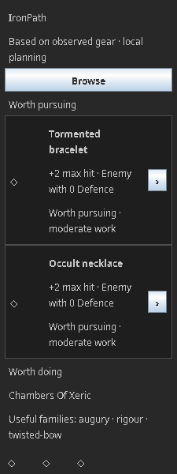
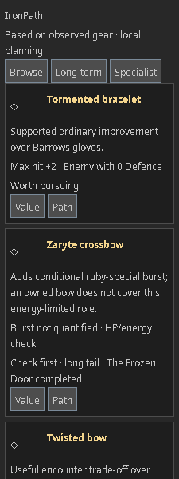
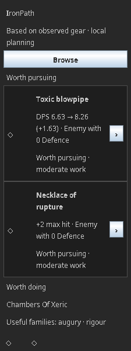
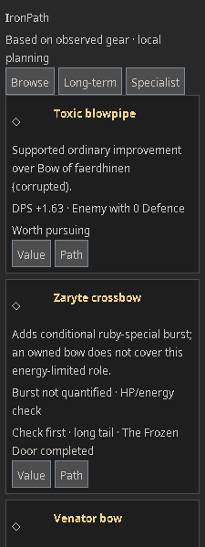

# R3a: relationship advice and native cards

13 October 2026. Plugin **0.8.0**, knowledge **r3a-1**, bundled schema **10**, policy **progression-1**. Implemented for review on PR #17 **75897d56d99e90a79b05931bbecddbc3c410212f**, including corrected R2 **32cb24a**. The implementation PR targets `docs/endgame-progression-intelligence`; #17 remains documentation-only. Neither dependency is merged by this work.

## What changes for an account

Subsequent client findings and their implementation are recorded separately: [coloured crystal/Blazing/treads](R3a-client-variants.md), then [Lightbearer, Specialist eligibility and Rosewood withdrawal](R3a-lightbearer.md). Original versions, counts and captures below retain their historical context; the latest build is 0.8.2 with 232 passing tests.

Personal importance, pursuit status and remaining work are independent. The ordinary comparison remains evidence for its own metric; it cannot erase reviewed burst, convenience or inventory roles. Among actionable choices, importance precedes preference, claim evidence and burden. Numerical ties only compare compatible role/target/setup/model buckets. Context-ID spelling, duplicate relationships and prose/target counts carry no priority. There is no Shadow-ID exemption or universal efficiency score.

The unchanged ordinary calibration distinguishes material gains at 5%; the new family policy distinguishes a major ordinary improvement at 25%. These are declared judgements over compatible comparisons, not thresholds for specials or QoL. Small accessory changes in a second target do not become significant merely by adding contexts. Reviewed weapon/weapon-switch trade-offs remain contextual. Qualitative confidence belongs to the claim, independently of DPS support. Unknown coordination/upkeep prevent unsupported numerical dominance.

| Pinned counterfactual | R2 behaviour / R3a result | Boundary |
|---|---|---|
| Post-Bowfa/crystal, fury, 99s, no anguish | Neutral ranged max hit 32→33, DPS 6.63→6.84 (+0.21) was minor ordinary value. R3a identifies the core neck gap as **Key improvement**, with the actual mould/resources check. | Importance does not establish route readiness or a universal percentage. |
| Add owned zenyte necklace `19535` and mould `1597` | Remaining assembly is bounded; no fresh gorilla stage. Add rupture `33639`: duplicate anguish acquisition disappears. | R2's owned-intermediate correction is preserved, not credited as new R3a work. |
| Swamp/Ahrim/fury magic reference; Shadow absent | Shadow retains neutral DPS **6.58→6.47 (-0.11)**. Its separately reviewed Graardor result gains **+2.31 DPS**, retaining contextual long-term value. | The card labels the encounter; Value retains the selected neutral loss. No added gains or inferred favourite boss. |
| Tbow candidate against owned Bowfa | Selected neutral result remains **6.63→1.96 (-4.67)**. The existing Zilyana comparison is **+0.10 DPS**, explicitly contextual and long-term. | This small niche is not a universal best-next grind. |
| Tbow owned; reviewed high-HP ruby context; Zaryte absent | Burst remains **Strong option** with component/access/energy checks. Clearing the context narrows the role; unknown context stays a check. | Expected burst, hit/proc distribution, HP caps and special-energy cycles remain unquantified. |
| Three megarares; Venator absent | Optional multi-target/attention value survives ordinary metric gaps. Owned Bowfa/blowpipe are named single-target or method alternatives, not bounce equivalents. | No assumed AFK preference, task list, XP rate or payback time. Explicit single-combat use removes only that role; reviewed Colosseum use can remain. |
| Four observed Venator shards versus five | Four is an observed lower bound with a remaining quantity check. Five bypasses Muspah acquisition/access and leaves uncharged-bow assembly. Both bow forms suppress duplicate acquisition. | Manual shard presence cannot prove five; bow ownership cannot prove charges/arrows/usable gear. No RNG progress bar or whole-item ETA. |
| Owned horn `26372` and ACB `11785`; unread shard quantity | Their drop stages disappear; 250 nihil shards and remaining assembly stay checks. | Owned parts never make unknown supplies cheap or ready. |
| Final Dawn/method reviewed; delve-2 scenario true; delve 3/4 unknown; tormented owned | Cloth can remain an independently eligible useful reward. Treads/Eye eligibility remains separate; it cannot veto cloth. | Planned completion is not observed ability to clear a delve. Unknown effort is not an immediate-grind claim. |
| Owned imbued heart, constrained essence, four shards | Heart-dependent material relevance and bow allocation conflicts are explicit. Sufficient observed 150,000 essence removes collection advice; uncertain remaining resources are listed separately. | The same essence/shards cannot fund competing uses. No simultaneous reward or additive time claim. |
| Reviewed Colosseum method; blowpipe owned; Venator absent | Quiver remains an available planning path; Venator is optional preparation with an adequate owned switch and one-hop reward explanation. | One-shot geometry, learning success and exact cycle times remain unsupported. |
| All delivered outcomes owned / partial bank | No filler priorities; partial ownership stays conditional with an explicit check. | Comprehensive role coverage and player usefulness are not established by this result. |

Original inputs are in `R3ProgressionTest`, `R3PanelTest`, `R2AdviceTest.postBowfa` and `R15Fixtures`. Snapshots use explicit synthetic bank IDs, counts, real levels, live/planning facts and absence confirmations; no goal. Missing ownership is never inferred from an empty/unread bank. A known weaker neck supports conditional core importance while unobserved alternatives keep the status at Check first; long-term discovery includes known tails even with ownership checks. References are complete proposed assumptions rather than actual equipped performance. The reproducible full report is generated under `build/reports/r3a/scenarios.md`; it includes every eligible outcome, comparisons and reason codes, rather than truncating catalogue coverage for the document.

## Native first impression

**Every image here is a synthetic Swing component capture with fallback/loading glyphs, not a real RuneLite sprite/client or player-usefulness pass.** Before images were freshly rendered from exact baseline `75897d5` in an isolated temporary worktree. Before/after post-Bowfa and three-megarare images use matching inputs and the same 225×600 viewport; no bank data or player screenshots were used.

| Post-Bowfa before | Post-Bowfa R3a |
|---|---|
|  |  |

| Three megarares before | Three megarares R3a |
|---|---|
|  |  |

The normal measured 213px inner width is one column. The rich post-Bowfa capture has two complete cards and a visible third: first card top 104 / height 176; Zaryte top 286 / height 236; tbow top 528 / height 216. Five complete previews fit the measured two-viewport budget; this count is a result of height, not an upgrade quota. Sparse accounts do not fill it. Large fonts produce taller intact cards and wrapping header/action links. Two columns require at least 346px inner width (170px cells plus gutter) **and** actual content fit, including the sprite's share of title width. The native host need not provide this width.

Preview order is calculated outside Swing. The first justified actionable choice stays first; the highest justified distinct long-term role and specialist representative precede repeated roles/families. Independent CoX rewards are not suppressed merely for sharing a source. Browse retains every eligible result, including conditional/deferred choices. Specialist uses reviewed role metadata; labels are not item-name rules. Important context losses and per-metric gaps remain in Value.

Value/body opens Value; Path enters directly at the remaining action/check. Child buttons have separate guarded handlers. Enter and Space use standard Swing button actions; static card prose adds no competing focus stops. Back retains category, card/action focus and scroll; updated data anchors to stable IDs. Profile clear resets prior navigation, and late action/image callbacks cannot apply an old view. ItemManager is used for genuine runtime imagery in fixed 40px wells; mocks validate requests/loading/isolation only.

Additional matching states:

| Evidence | Evidence |
|---|---|
| [20px font, all text/actions retained](../images/r3a/post-bowfa-large-font.png) | [Baseline enlarged font](../images/r3a/before-large-font.png) |
| [Browse with the same cards](../images/r3a/post-bowfa-browse.png) | [Specialist filter](../images/r3a/specialist.png) |
| [Tbow Value retains neutral loss](../images/r3a/tbow-neutral-value.png) | [Direct Path](../images/r3a/tbow-path.png) |
| [Venator Path and adequate alternatives](../images/r3a/venator-path.png) | [Long-term-only state](../images/r3a/long-term-only.png) |
| [Partial/unknown state](../images/r3a/partial-home.png) | [All delivered outcomes owned](../images/r3a/all-owned.png) |
| [Loading imagery, not real sprites](../images/r3a/loading-images.png) | [Clear before delayed image arrival](../images/r3a/cleared-after-delayed-image.png) |
| [Empty observation state](../images/r3a/empty.png) | All images are 225×600 logical pixels. |

## Supported portions of the PI matrix

These are exercised synthetic policy/component portions, **not full profile acceptance** or player judgements. Exact inputs are pinned in the test fixtures/report; the supplied 99s fixtures are not represented as exact replicas of every planned account.

| Profiles | Exercised result | Explicitly pending |
|---|---|---|
| PI01–PI02 | Manual ordinary-team preparation remains distinct from access; independently useful/owned CoX reward families change activity reasons. No lance/maul grind is introduced by R3a. | Exact lance/Fang/Scythe adequacy, teammate reduction allocations and raid recipient/pace models. |
| PI03–PI04 | Optional Venator convenience, named owned switches, direct quiver path, one-hop explanation and a no-benefit single-combat counterfactual. | Exact revised return-bounce/one-shot arrangements, SGS restore model, attention preference promotion and learning outcomes. |
| PI05 | Quest access, method review and per-reward planning eligibility remain separate; unknown treads cannot block known cloth eligibility. | Automatically validated Scorching/Void/demonbane package, actual delve ability and encounter models. |
| PI08 | Horn/ACB and four/five-shard counterfactuals retain exact component scope and unknown resources. | Whole-route probability/time, stock allocation decisions and charge usability. |
| PI09–PI10 | Megarare ownership does not erase missing utility; every delivered outcome owned yields no filler. | Comprehensive melee/sustain/permanent-utility coverage and live user relevance. |
| PI11–PI12 | Heart-dependent essence, sufficient/uncertain stock, non-additive allocation conflicts, ownership uncertainty and stale view/identity guards. | Sceptre outcomes, supply tracking outside supported observations and actual client checks. |
| PI14–PI15 | Owned treads stop duplicate base acquisition; scroll/unlock observations and original no-false-absence protections remain intact. | Individual treads attachment outcomes/quantitative switches, consumed/active penny and four-rune pouch modelling. They remain gaps, not new grinds. |
| PI16 | Reviewed current switches permit starting a method while optional Venator work retains independent convenience value. Utility feedback/aliases do not amplify rank. | General preparation optimisation, broader role equivalence and comparable total detour-effort evidence. |

## Verification and review boundaries

Temurin **11.0.32.1**, Gradle **8.10**, resolved RuneLite **1.13.1**, Linux headless Java/Swing. Normal command:

```sh
source /workspace/ironpath-environment/activate.sh # cloud workspace only; PC uses its JDK 11
./gradlew test build --no-daemon
```

**219 tests; zero failures, errors or skips.** All 195 baseline tests remain, with explicit expectation migrations for superseded policy/layout: burden-first ordering, the 100px two-column rule, row-first discovery, neutral-only deferral despite valid encounter value, and false preparation treated as hard access. Historical R1-only fixture helpers exclude the newly shipped R3a outcome. Numeric assertions, formula modules and all oracle resources are unchanged, including **1,944 original complete ranged cases**. Ownership, ammo/slot incompatibility, per-metric model gaps, reference lifecycle, profile guards and serial preference IO continue to pass. `git diff --check` passes.

Affected new tests cover core importance versus minor neutral gain, independent utility versus negative ordinary evidence, owned alternatives/intermediates, resource lower bounds, eligibility isolation, optional preparation, claim withdrawal, hard cycles, utility feedback, context aliases, no filler, measured density, font/layout thresholds, direct Path, child/body actions, Back/filter/scroll anchors and late images/actions. Captures verify component layout only. The original R1/R1.5/R2 reports and their pending live evidence are preserved.

Schema 10 explicitly retires shared `minDelve` in favour of generic eligibility conditions; old fields are rejected rather than becoming a second source of truth. Persisted preference schema **2**, stable outcome/route IDs, local Filepath storage and raw-observation privacy are unchanged. New contexts/roles/resources extend the existing predicate/source checks. No rule language, combat-model rewrite, new dependency, backend, runtime scraping, gameplay automation or publication.

Pinned new evidence: Venator bow **15345156**, shards **15371536**, Muspah **15367478**, strategies **15371265**, essence **15326865**, Secrets of the North **15325015**, saturated heart **15371902**, Colosseum strategies **15370386**. Factual/strategic claims have source dependencies and original explanations. Detailed Venator geometry remains explicitly unvalidated despite its general released multi-target role. No prose, artwork, calculator code or dataset was imported. The existing licences/notices remain.

| Actual-client / player check | Status |
|---|---|
| Genuine ItemManager sprite success and asynchronous loading | Petter subsequently supplied client screenshots with visible item sprites; this establishes visible sprite success for those examples only. Async/lifecycle acceptance and post-fix retest remain **pending**. See [client findings](R3a-client-variants.md). Original synthetic captures retain their provenance. |
| RuneLite/OS viewport and 100/125/150/200% scaling | **Pending**; the software captures and explicit font tests do not emulate OS/client DPI. |
| Actual mouse/keyboard/focus/Back and profile/world switching | **Pending**; component/lifecycle regressions pass, not a client pass. |
| Player finds a useful upgrade, explains its trade-off and reaches the next step | **Pending**; synthetic relevance/counterfactual evidence is not player evidence. |

Full melee, specials, exact bounce geometry, permanent rewards, raid odds/hours and encounter/trip metrics remain tracked in TASKS/CATALOGUE. This is useful bounded R3a delivery, not comprehensive endgame coverage or a polished-client/Plugin Hub acceptance claim.
