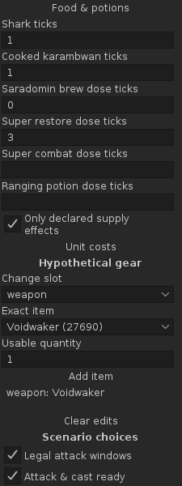
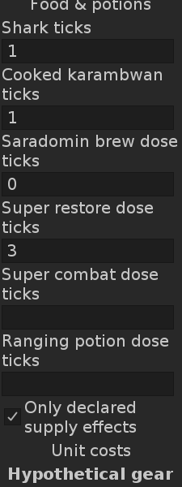
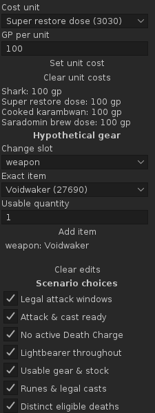
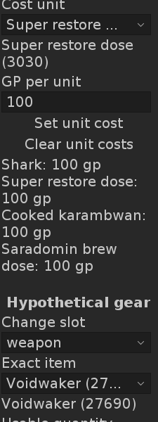

# N3 decision support validation

19 October 2026. Development build **0.24.0**, for review, based on consolidated
main `7f68d0e`. [Numerical/evidence contract and source review](../research/nex-decision-support.md).
The PR records the delivery commit and current-head CI/report artifact links.

## Delivered

- An unknown captured window stays unknown instead of becoming a base window.
  Matching vulnerable minion scenarios use separate catalogue targets and reviewed
  non-Magic flat armour. Zaros/other special effects keep scoped damage gaps.
- Six finite declared food/potion families share the existing package/resource
  plan. Dose stock, separate eating/drinking bounds, combos, displaced ordinary
  attacks and brew/restore/reboost levels are checked. A new unchecked supply
  declaration gates nonempty use lists; no inventory-loss attribution is added.
- Selected complete-pair results keep higher/same/lower and actual-to-owned versus
  marginal-upgrade results separate. Explicit unit GP produces scoped ammo/supply
  costs; missing prices remain unavailable and explicit zero remains distinct.
- Exact changed hypothetical items expose retained catalogue route facts. No
  missing-component, readiness, personal drop-odds, pace or full-item ETA is inferred.
- Worker-frozen costs, schema-3 allowlisted plan export, selectable clipboard
  fallback, invalidation and existing view/session/history/Reset guards are retained.

## Performed checks

JDK **11.0.32.1**, Gradle **8.10**, RuneLite **1.13.2**, DejaVu Sans body fonts
**12/20**, native **225px** panel. Final commands run sequentially:

```sh
source /workspace/ironpath-environment/activate.sh
./gradlew -PruneLiteVersion=1.13.2 test build offlineReview --no-daemon
./gradlew test build --no-daemon
```

The normal compatibility command resolves the same RuneLite 1.13.2 classpath.
Both final commands **PASS**: **359 tests across 43 suites, zero failures/errors/skips; 14 DEV1 scenarios, 997 checks, zero failures and 220 PNGs**. The final pinned run executes the full suite and regenerates all scenarios; the following normal compatibility run reuses the same successful outputs.
Existing Gradle/RuneLite deprecation and headless Fontconfig messages are non-fatal.
An initial offline compile could not resolve the restored dependency cache; online
resolution succeeded. An intermediate normal run overlapped another Gradle test
writer and could not write XML; that run is invalid evidence. Final commands above
run sequentially. An initially overbroad source-file allowlist was caught by the
existing catalogue regression and tightened before the passing full suite.

Hand-checked tests cover the 4-tick launch at offset 0 followed by shark +3 and
karambwan +2 at offset 1: ready shifts to 9, so opportunities 4/8 spend nothing and
12 is admitted. Idle food creates no fictitious lost attack. Three brews lower a
118 Strength state to 82; restore returns it to 99, then super combat to 118.
A restore never recreates a lost boost. Unknown unused skills do not suppress
independently supported melee/ranged levels; an affected missing base level
removes that dependent level rather than retaining a stale value. Four- and three-dose bottles pool to seven
doses, while insufficient/unknown stock and potion/eating cooldown conflicts fail.

Target checks verify all four phase mappings and their own defence rolls, accurate
non-Magic -2 armour, preserved misses, Magic-type Voidwaker bypass and transform
ordering before HP/hard caps. Unknown windows, mismatched minion phases and Zaros
preserve spec-energy results while withholding dependent damage. Cost checks cover
missing versus explicit-zero prices, exact admitted ammo and declared supply units,
negative-price rejection and exact catalogue route availability. Export checks
retain fixed enums/versions and omit private sentinels/target identity strings.

The existing `nex-n3-plan` DEV1 scenario now takes frozen public-event capture
through native supply/cost editors, an unconfirmed-supply rejection, the real worker,
400 gp for four declared units, delayed attacks, clipboard fallback, unknown HP,
a new kill with frozen older inputs, and stale Reset. All previous scenarios remain.
No second replay harness or private account fixture is introduced.

## Native inspection

The first native inspection caught a clipped dynamically updated cost list and
small inherited labels inside the enlarged form. Both now use the existing
width-aware native column/text helpers. Final 225 × 600 viewports at 12/20 show
all six supply fields and the explicit supply confirmation, plus the cost unit,
price input and complete four-unit summary. Full-height/editor/results/report
screens and geometry checks supplement actual whole-image inspection.

| Food/potions, 12 | Food/potions, 20 |
|---|---|
|  |  |

| Unit costs, 12 | Unit costs, 20 |
|---|---|
|  |  |

These four selected synthetic native previews are retained for review; routine
reports/other generated files remain build artifacts. Artwork/Jagex provenance
and existing test boundaries remain unchanged.

## Remaining acceptance

No live RuneLite/gameplay test was performed. Actual launch/HP/readiness/restore/
cast/death/consumption attribution, Zaros overhead/stat effects, raw usable stock
readings, native DPI/focus/scroll/clipboard and player usefulness remain open.
The implementation intentionally withholds unsupported automatic recommendations.
Declared HP is not a healing/target-HP trajectory; branch costs exclude other gear
upkeep, spell runes, acquisition and whole-trip cost. No survival, contribution,
team-time, Plugin Hub approval, merge or publication is established by these tests.
