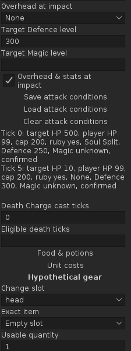
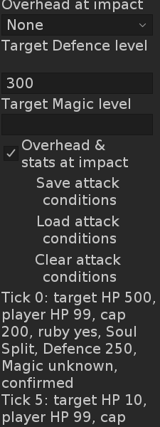

# N3 independent impact conditions

20 October 2026. Development build **0.26.0**, for review in PR #50, extends
`844ec75d8191d5b1a60621c051d02c891e810a3e` on consolidated main `7f68d0e`.
The PR records the exact delivered commit and current CI artifact.
[Contract](../research/nex-decision-support.md) · [Previous Zaros/spell evidence](nex-zaros-spells.md).

## Result

The optional **Use per-attack conditions** mode supplies independent target/player
HP, hard caps, ruby eligibility and Zaros overhead/Defence/Magic at each declared
attack tick. Saving a row is explicit. Loading an unsaved tick shows unknowns and
an unchecked impact confirmation; it copies nothing from fixed fields or earlier
rows. Unsaved drafts and removed attack ticks receive a brief field-specific
message before work is queued. Fixed mode remains available as an explicit choice.

The runtime constructs one shared immutable conditions list for captured, owned
and hypothetical packages. The special and its same-tick ordinary fallback use
the same impact inputs; finite stock/energy, package delays and supply effects
continue through the existing engines. An admitted unknown/unsupported impact
withholds dependent damage/deltas while independent resources remain available.
A cooldown-rejected opportunity neither spends stock nor adds a damage gap.

Schema-5 reports export the active mode and each opportunity's declared values.
They retain the existing 24,000-character bound, omission notice, allowlist,
synthetic provenance and selectable clipboard fallback. Every edit invalidates
old results/exports immediately. New kills keep the inspected result frozen;
request/view/session/Reset guards continue to reject stale work. Nothing new is
persisted, uploaded or read from the account after the inputs freeze.

## Verification

Targeted unit tests cover independent HP caps, per-attack Defence rolls, immutable
maps, fixed/earlier-input isolation, same-tick fallback, unknown/deflect/unconfirmed
impacts, ruby/player-HP changes, finite stock, invalid keys/bounds, report
truncation, unsaved drafts, removed ticks and stale publication.

The existing `nex-n3-plan` DEV1 scenario exercises public capture, the actual panel,
worker and frozen export at native 225px with body fonts 12/20. It includes
missing rows, separately declared values, new-kill freezing, edited pending work
and Reset. Full-height panels and 225 × 600 HP/Zaros viewports are generated.

Both required commands passed sequentially using JDK 11.0.32.1, Gradle 8.10
and RuneLite 1.13.2:

```sh
./gradlew -PruneLiteVersion=1.13.2 test build offlineReview --no-daemon
./gradlew test build --no-daemon
```

**377 tests / 44 suites; 14 DEV1 scenarios / 1,073 checks; zero failures,
errors or skips.** The standalone run generated **234 PNGs**, including **60
native 225 × 600 viewports**. The normal compatibility build resolved the same
dependency/classpath and reused up-to-date tasks; it does not establish a newer
RuneLite release. Changed-document local links and `git diff --check` pass.

Inspected per-attack HP/Zaros viewports at both body fonts 12/20 plus full-height
input/result screens. Fields, wrapped checkbox/button labels, saved values,
independent results and selectable report remain readable. The longer form
scrolls at enlarged fonts; no single-screen form claim is made. The complete
PNG/report set belongs to the current CI artifact, with two representative native
views retained here.

| Per-attack Zaros, 12 | Per-attack Zaros, 20 |
|---|---|
|  |  |

## Remaining acceptance

These are hypothetical conditions at independently declared impacts. No automatic
launch/consumption attribution, exact NPC HP, impact-time mapping, Soul Split
healing, Turmoil transfer, deflection exception or overhead cadence is established.
The existing mechanic/source review is reused without new formulas or external
data. No healing trajectory, survival, best-spec or N4 team-time claim is enabled.

Live RuneLite/player acceptance, real target/stock readings, DPI/focus/scroll and
clipboard behavior remain open. No merge or Plugin Hub publication.
