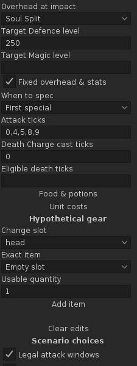
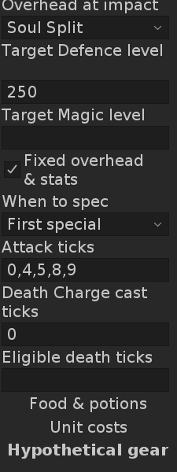

# N3 Zaros context and spell resources

Development build **0.25.0**, for review in PR #50, based on consolidated main
`7f68d0e` and the existing 0.24.0 decision-support delivery. The PR records the
exact delivery commit and current CI artifact. [Final contract and source hashes](../research/nex-decision-support.md)
and [0.24.0 evidence](nex-decision-support.md).

## Result

Public target forms/health ratios now freeze with the selected captured package.
Unknown readings remain unknown, and losing the target never carries its former
reading forward. Zaros overhead changes survive package deduplication. The state
selector uses a unique ordinal because same-tick states can otherwise have equal
display strings and Swing would select the first one. The regression reproduces
normal Nex and Soul Split at the same tick through public callbacks.

The optional Zaros editor requires an unchecked fixed-window declaration and
explicit target Defence; Twisted bow additionally needs target Magic. Observed
form may seed an overhead choice but supplies no target levels/HP or confirmation.
Whole packages derive their own rolls against the declared levels. A missing
unused Magic level does not block a melee/crossbow result. Deflect Melee keeps
melee packages, including unreviewed special exceptions, as scoped damage gaps;
independent resource results remain available. No shared target record is mutated.

Declared Death Charge casts now need finite normal Death/Blood/Soul stock and
Magic 80 at admitted casts after declared supplies. Frozen loose runes and the
public contents of a carried exact pouch can fund the same total across packages.
Missing pouch data cannot invalidate independently sufficient loose runes. Pouch
contents supply nothing when that pouch was absent from the captured inventory.
Cooldown-rejected casts consume no runes. Admitted units join the existing scoped
cost ledger and allowlisted schema-4 report. Other spending/substitution stays
outside this branch. Same-tick supplies must precede other actions; unsupported
order is rejected instead of applying future level changes to an earlier cast.

## Verification

Commands are run sequentially using the prepared JDK 11 environment:

```sh
source /workspace/ironpath-environment/activate.sh
./gradlew -PruneLiteVersion=1.13.2 test build offlineReview --no-daemon
./gradlew test build --no-daemon
```

Final pinned validation **PASS**: **370 tests / 43 suites, zero failures/errors/skips;
14 DEV1 scenarios / 1,025 checks, zero failures; 226 PNGs**. All 56 exported
viewports are 225 × 600. JDK **11.0.32.1**, Gradle **8.10**, RuneLite **1.13.2**,
DejaVu Sans body fonts **12/20**. Existing deprecation and headless Fontconfig
messages are non-fatal.
The following normal compatibility command also **PASS**ed, resolving the same
RuneLite classpath and reusing the successful test/build outputs.

The first complete run found equal-label same-tick selection, two privacy tests
matching `25.0` inside the new build number instead of the damage-share field,
and an old assertion expecting rune costs to remain excluded. The selection bug
and assertions were corrected before the passing full run. No overlapping Gradle
writers were used. Document links and `git diff --check` pass.

Focused regressions exercise hand-checked Defence rolls at levels 250 and 300,
Twisted bow Magic dependency, unknown overheads/levels, deflection gaps, immutable
target readings and catalogue data, stale edits/reports, finite runes, cooldown
rejections and Magic lost/restored through supplies. Three admitted casts with
one rejected between them spend three of each normal rune; prices 100/200/0 GP
give 900 GP. Two brews drain Magic 99 → 88 → 78, preventing a declared cast until
a restore supplies the required level. Existing arithmetic/lifecycle/retention,
report privacy, selection and Reset regressions remain in the full suite.

The existing `nex-n3-plan` DEV1 scenario additionally captures a public Soul Split
form/health bar, selects its same-tick frozen state, withholds unknown Zaros damage,
checks the unchecked editor and rune stock, recomputes a declared window on the
real worker and exports matching schema-4 target/rune inputs. It runs the actual
Swing panel at native 225px, body fonts 12/20, with full-height and 225 × 600 views.

Native images were inspected at both fonts. Overhead, target-level fields, the
wrapped fixed-window control and the nearby cast fields remain
readable. Full-height result/export screens preserve the captured versus declared
target/rune data. Only two representative generated previews are retained in Git;
all synthetic reports/full-height screens remain CI artifacts.

| Zaros declarations, 12 | Zaros declarations, 20 |
|---|---|
|  |  |

## Limits and acceptance

No live RuneLite/gameplay acceptance was performed. The official public API
transmits health-bar ratios rather than real NPC HP; these cannot satisfy the
current exact per-launch HP contract. Legal launch/initial-readiness/restore-order,
actual cast/death/supply attribution and dynamic transfers/impact overheads remain
unestablished. A declared scenario does not close those automatic evidence gates.
No captured kill is promoted into a reconstructed or globally ranked spec plan.

Real pouch/stock readings, native DPI/focus/scroll/clipboard and player usefulness
need client acceptance. Soul Split healing, Turmoil transfers, deflection exceptions,
other special windows, rune substitutions, healing/survival trajectories and N4
contribution/team-time estimates are not enabled. No merge or Plugin Hub publication.
