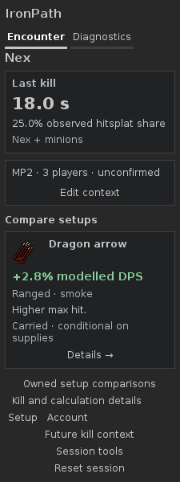
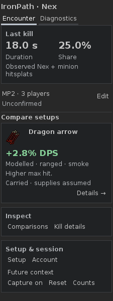
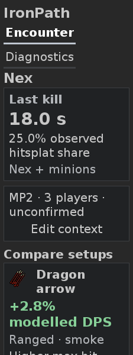
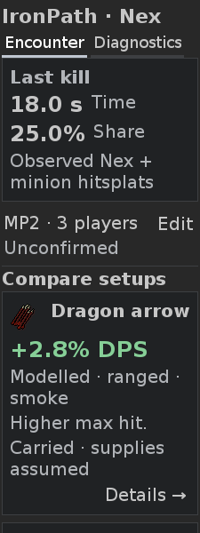
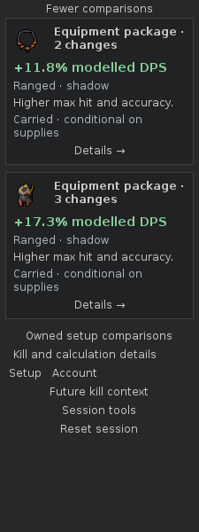
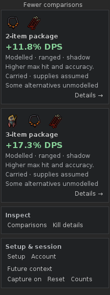
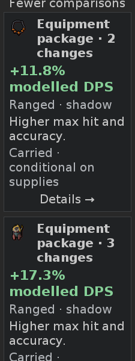
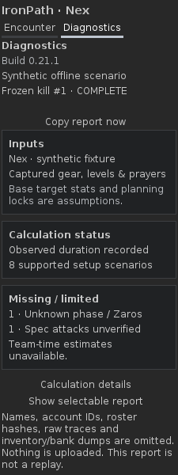

# PR #46 — visual refinement and genuine item sprites

18 October 2026. Review iteration of **0.21.1**, continuing the same PR and its
dependency on corrected CTX1 #43 (`2fe5342`). No dependency merge, main-branch N3
integration or publication is performed here. The PR records its exact delivery
commit and current CI run/artifact.

Created using intellectual property belonging to Jagex Limited under the terms of Jagex's Fan Content Policy. This content is not endorsed by or affiliated with Jagex.

## Whole-screen refinement

Compared with the existing Encounter / Diagnostics reference from issue #44,
the previous screen spent too much space on navigation, separate context framing
and loose secondary actions. The new native layout keeps the sequence **last
kill → compact context → useful comparisons**, with a shared IronPath / Nex heading.
The result uses two columns at the normal font and readable value/label rows at
the enlarged font. The context is a quiet strip with Edit alongside it, retaining
confirmation status and unknown/mass/variable distinctions.

Equipment cards emphasize the actual sprite, changed-item/package name and green
supported DPS benefit. Modelled role/phase, the short reason, carried/supply or
bank/packing scope, partial-search and unmodelled-alternative qualifications remain
secondary readable text. Details has one consistent position at the bottom right.
Multi-item packages show several genuine changed-item sprites and an explicit
item-count/package label. The first two deterministic cards remain initially
visible; further comparisons expand without ranking unrelated percentages.

**Inspect** groups comparisons and kill details. **Setup & session** groups Setup,
Account, future context, capture, Reset and counts. Existing actions remain
discoverable, with the same mutation/read guards, frozen selection, Back and
remembered scroll behavior. No calculation, context provenance/confirmation,
resource attribution, privacy or lifecycle contract changes.

Body fonts remain **12/20**. Enlarged navigation uses **18px**, with spacing around
both complete tab labels on one row; headings and numerical benefits use larger
type. Native sprites retain their genuine 36 × 32 pixels. These type/layout
choices replace the former stacked navigation and cramped percentage tile.

## Same-fixture native before/after

All selected images are actual **225 × 600 JViewport** renders with RuneLiteLAF
and DejaVu Sans. Full-height counterparts were also inspected. Before uses
production code at `997f9237536126fd823d36f7850222224c188ce7`, with only test-boundary
sprite injection and the added public-event visual fixture. Both versions use
the same genuine PNG bytes and identical fixture inputs/callbacks. These are
synthetic plugin previews, not real-client captures or concept images.

The original `nex-complete` fixture retains its 18.0-second observed interval,
25.0% hitsplat share and supported Dragon arrow comparison. `nex-visual` extends
the existing DEV1 pipeline with public equipment switches omitting head, neck
or both while owned alternatives remain carried. Its explicit Scorching bow
gap demonstrates supported-domain limits. It creates four independent positive
cards, including 2/3-item packages, without injecting completed summaries or
manufacturing numerical gains. No new formulas or whole-kill rankings are added.

| Encounter, 12 — before | Encounter, 12 — after |
|---|---|
|  |  |

| Encounter, 20 — before | Encounter, 20 — after |
|---|---|
|  |  |

| Further comparisons, 12 — before | Further comparisons, 12 — after |
|---|---|
|  |  |

| Further comparisons, 20 — before | Further comparisons, 20 — after |
|---|---|
|  |  |

| Diagnostics, 12 — before | Diagnostics, 12 — after |
|---|---|
|  |  |

[Enlarged Diagnostics before](images/ui1-46/before-diagnostics-20.png),
[after](images/ui1-46/after-diagnostics-20.png) and expanded calculation details
after a real synthetic inventory refresh at [12](images/ui1-46/after-calculation-details-12.png)
and [20](images/ui1-46/after-calculation-details-20.png) are also retained.

## Visual inspection against the reference

The [existing primary reference](https://github.com/PetterHL/ironpath/blob/46fbb903defbe3eacf2512bc7c51d9ac614ca42b/docs/ui-references/ui1-44/encounter-diagnostics-reference.png)
continues to govern the visual hierarchy. Inspected the screen as a whole at
both fonts, then full-height and scrolled expanded views for wrapping/overflow.
Dark separated surfaces, quiet context, genuine item imagery, prominent benefits,
consistent Details placement and grouped controls now carry that hierarchy.

The initial render still stacked the enlarged tabs and split the share value
across lines; a second render showed adjacent tab names with insufficient
separation. The finished navigation and metric layout address those findings.
The main font-20 screenful includes the first item, supported benefit, reason,
material carried/supply scope and Details. Larger sets of comparisons and tools
use ordinary vertical scrolling. The long expanded-package render remains
readable at full height; an unmodelled alternative has its explicit qualifier.
A full-height/viewport comparison also caught a compressed sprite row caused by
reparenting into the capture viewport. The harness now settles the same nested,
width-dependent layouts before scrolling/painting; the final scrolled package
views retain the genuine icons at both fonts. Geometry checks support inspection
and are not treated as visual acceptance.

Material adaptations: one 225px sidebar; two supported observed results instead
of the concept's four example metrics; no decorative boss/banner or invented
time savings; explicit CTX1 context; only genuine supported alternatives. Scope
and missing support remain attached to claims. The broader actual/owned/upgrade,
acquisition/resources and N4 roadmap is unchanged.

## Sprites and production loading

Twelve unmodified PNGs are pinned by ID, dimensions and SHA-256 in
[the preview manifest](../../src/test/resources/com/ironpath/sprites/manifest.json).
They were retrieved from RuneLite's item-image service on 18 October. The
[third-party notice](../../THIRD_PARTY_NOTICES.md#preview-game-artwork) records
Jagex ownership, separate terms, policy version and required attribution. No
Wiki image/prose, generated approximation or external calculator code is copied.

`OfflineSprites` lives in test sources. It supplies genuine pixels through a mock
ItemManager and the real RuneLite `AsyncBufferedImage` / `getImage` / `addTo` path,
which is also used by production. Missing pinned IDs fail explicitly. No runtime
web download or new production sprite loader is added. The normal plugin JAR
excludes preview PNGs/test classes; the development shadow launcher retains its
existing test-resource inclusion.

The production-path regression verifies the requested item ID, paints the real
icon, checks its visible pixels, rejects a stale setIcon and completes a genuinely
pending image after identity clearing without reattaching it to the current UI.
Manifest integrity checks verify every asset's exact bytes and dimensions.
Live cache integration/sprite acceptance still requires the real client.

## Diagnostics correction and validation

Calculation details now binds its expanded/collapsed state to the accessible
selected kill. Unrelated inventory/equipment/bank snapshots retain it; a newer
kill cannot replace a frozen inspection. An explicitly collapsed section stays
collapsed. Selecting a different kill, identity/reset, suspension or loss of the
retained record clears disclosure state and its reference.

The focused regression **fails on `997f923`** at the first inventory refresh
(`Keep expanded calculation details after Inventory refreshed`) and passes with
the correction. The public-event `nex-visual` replay additionally changes the
actual synthetic inventory, runs the normal plugin refresh and captures expanded
Diagnostics at both fonts. Frozen report/clipboard and CTX1 active-encounter
regressions remain in the same suite.

Commands use JDK 11.0.32.1, Gradle 8.10 and RuneLite 1.13.2:

```sh
./gradlew -PruneLiteVersion=1.13.2 test build offlineReview --no-daemon
./gradlew test build --no-daemon
./gradlew dependencyInsight --dependency net.runelite:client --configuration compileClasspath --no-daemon
git diff --check
```

Final pinned validation passed: **314 tests, zero failures; 13 DEV1 scenarios,
835 checks, zero failures; 178 PNGs**. Normal test/build passed with the same
outputs up to date; `latest.release` resolves to **1.13.2**, with no newer-version
compatibility claim. The standard plugin JAR was inspected to confirm it excludes
preview sprite resources and test classes. Edited-document relative links,
selected 225 × 600 image dimensions and `git diff --check` pass. Fontconfig's
non-writable-cache warning did not skip any DejaVu font assertion or render.

Real-client cache/sprites, event mappings, focus/keyboard/scroll/DPI, clipboard,
bank/reload retesting and player acceptance remain **open**. The user retains
merge control. Synthetic preview evidence establishes neither live acceptance
nor Plugin Hub/Jagex approval.
