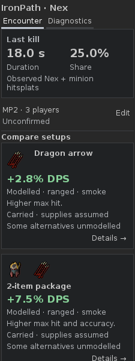
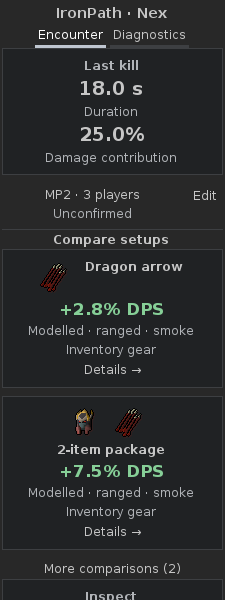
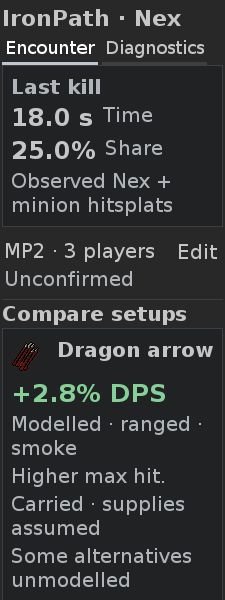
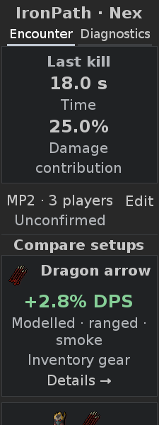
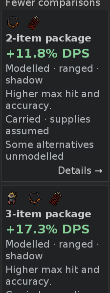
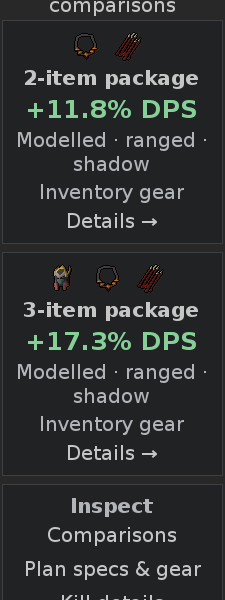
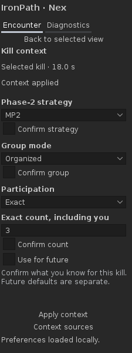
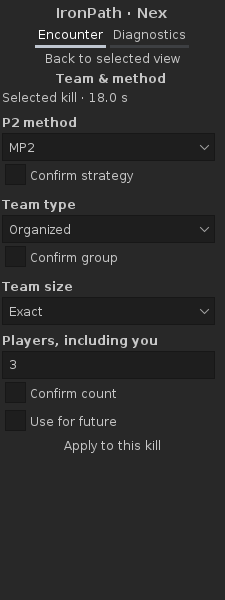
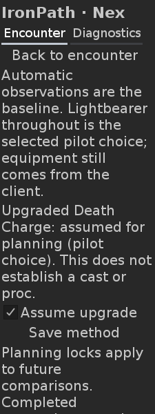
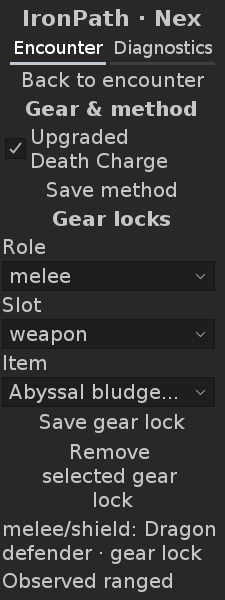

# UI1 #47 — OSRS wording, concise screens and centred layout

19 October 2026. Development build **0.23.0**, for review. Exact delivery commit,
current CI run and `dev1-offline-review` artifact are linked in the implementation
PR. Live gameplay acceptance remains open; this offline round requires no new kill.

## Integration and provenance

The dependencies were rechecked at task start:

| Delivery | Verified commit / state |
|---|---|
| Main, including N3 runtime plans #45 | `b47b9e76217cf7ad3e611ecdb5e2e6372cc84934` |
| CTX1 #43 | `2fe53429526a2e43a6489e48af3cfba596925b03`, open |
| Native UI1 #46 | `d5b14db02a81e40a29a26233e16b8d6d542ef503`, open, targeting CTX1 |
| Isolated pre-refinement integration | `32c379d764c2c0a038fb85cba846f19f16cd41c3` |

Branch `ui1/47-wording-centred` starts from current main and merges the full #46
lineage, including CTX1. Both parents are retained in the integration commit.
Neither open GitHub PR, feature branch nor main was merged/overwritten/published.
Conflicts retain N3 resource reports and pending-selection correction alongside
CTX1 record/revision guards and UI1 disclosure state. `NexEvaluation` forwards
frozen scenario unlock facts as well as context/input/model revisions; a focused
context regression retains explicit true and unknown equip facts across correction.
The combined regression suite passed before presentation changes began.

Before images use production at **32c379d**, with the same test-only genuine-sprite
fixture and viewport position/clamping correction used for after images. An
isolated detached worktree regenerates them; no final production UI is substituted
into the before build. `nex-visual` drives public equipment switches omitting head,
neck or both, retaining carried alternatives. `nex-n3-plan` declares the same
window/HP/stock/attacks and hypothetical Voidwaker in both versions. The old single
confirmation and new explicit choices declare the same known shared readiness.
No completed summary, gain or item art is invented for these images.

All selected viewports are actual **225 × 600** RuneLiteLAF/DejaVu Sans Swing
renders at body fonts **12 and 20**. Full-height evidence accompanies them where
needed. Source sprites, exact IDs, hashes and notices remain the retained fixtures.

Created using intellectual property belonging to Jagex Limited under the terms of Jagex's Fan Content Policy. This content is not endorsed by or affiliated with Jagex.

[Artwork provenance and separate terms](../../THIRD_PARTY_NOTICES.md#preview-game-artwork).

## Result and preserved behavior

- Encounter, Compare setups and genuine item-count package labels remain. All
  agreed OSRS labels are applied to normal controls, relevant tooltips and
  accessibility names; [the active UX mapping](../UX.md) records them.
- Damage contribution is a display-label change. The same independently checked
  18.0-second interval and 25.0% observed hitsplat ratio remain. Exact target/scope
  and server-loot-credit distinctions move to Diagnostics.
- Normal Encounter/cards, gear/unlock settings, team editor, ordinary kill/gear
  details, resources and optional planner show results, concise labels and controls.
  Help/scope/assumption/testing/future-work prose, provenance, detailed gaps,
  resource readings and raw capture traces live in common Diagnostics → Calculation
  details or an explicitly opened report. Existing useful gear Details remains.
- Equipped gear means changed items already worn in the captured state. Inventory
  gear means carried alternatives; Bank gear remains conditional preparation.
  Hypothetical gear is separately labelled. Search, package membership, exact
  variants, negative/zero alternatives and deterministic ordering are unchanged.
- Account choices render readable descriptions while retaining internal keys.
  Missing descriptions enumerate every exact member of the existing ownership set;
  tests include both Fang forms, every treads variant and other formerly raw keys.
  There is no broad alias/catalogue rewrite.
- The N3 confirmation paragraph becomes nine explicit unchecked choices. Each one
  independently gates shared readiness and dependent finite/damage results.
  Numeric unknowns stay unknown. The fixed definitions are in Diagnostics; no
  hidden confirmation is ticked. Plan report export retains the choice snapshot,
  frozen inputs and scoped gaps, remains bounded and offers selectable clipboard
  fallback. Technical report text appears only after the explicit Copy action.
- Headings, values, coherent sprite/name groups, package sprites and actions are
  centred within the existing column. Long item names retain natural reading
  alignment within their group; forms, tables and Diagnostics prose stay left
  aligned. Body fonts are unchanged; retained enlarged navigation uses 18px.
- Routine successful load/save/observation confirmations disappear from normal
  screens. Save/input failures remain brief and clear when resolved. Empty status
  rows occupy no height. Short forms keep their natural height instead of spreading
  spare viewport height between fields. Focused viewports clamp to a valid scroll
  range; short-panel captures reset to the top instead of painting a blank view.

No combat formula, contribution attribution, boss, acquisition feature, automatic
spec recommendation, target-HP trajectory or N4 estimate is introduced. Account,
profile/world/reset/banking guards, pending/stale publication, frozen selections,
Back/scroll, CTX1 drafts and expanded Diagnostics remain covered by the same harness.
No account history/raw trace persistence, automatic export or upload is added.

## Native before / after

| Encounter, font 12 — before | After |
|---|---|
|  |  |

| Encounter, font 20 — before | After |
|---|---|
|  |  |

| Multi-item package, font 20 — before | After |
|---|---|
|  |  |

| Team editor, font 12 — before | After |
|---|---|
|  |  |

| Gear settings, font 20 — before | After |
|---|---|
|  |  |

Both-font before/after files also cover unlock settings, Diagnostics and the N3
planner. The planner's `*-planner-*` images are 600px viewports ending at its
Compare control; `*-planner-full-*` retain the complete fields/old prose/new
scenario choices. They are native renders, not crops or generated concepts.

[Package 12 before](images/ui1-47/before-package-12.png) ·
[after](images/ui1-47/after-package-12.png) ·
[Team 20 before](images/ui1-47/before-team-20.png) ·
[after](images/ui1-47/after-team-20.png) ·
[Gear 12 before](images/ui1-47/before-gear-12.png) ·
[after](images/ui1-47/after-gear-12.png).

| Surface | Font 12 before / after | Font 20 before / after |
|---|---|---|
| Unlocks | [Before](images/ui1-47/before-unlocks-12.png) / [After](images/ui1-47/after-unlocks-12.png) | [Before](images/ui1-47/before-unlocks-20.png) / [After](images/ui1-47/after-unlocks-20.png) |
| Diagnostics | [Before](images/ui1-47/before-diagnostics-12.png) / [After](images/ui1-47/after-diagnostics-12.png) | [Before](images/ui1-47/before-diagnostics-20.png) / [After](images/ui1-47/after-diagnostics-20.png) |
| Planner viewport | [Before](images/ui1-47/before-planner-12.png) / [After](images/ui1-47/after-planner-12.png) | [Before](images/ui1-47/before-planner-20.png) / [After](images/ui1-47/after-planner-20.png) |
| Full planner | [Before](images/ui1-47/before-planner-full-12.png) / [After](images/ui1-47/after-planner-full-12.png) | [Before](images/ui1-47/before-planner-full-20.png) / [After](images/ui1-47/after-planner-full-20.png) |

Whole-image review includes the main first screen, expanded 2/3-item packages,
long names/wrapped actions, settings at both fonts, the full planner and resource/
report output, and expanded Diagnostics. Iteration corrected left-aligned wrapped
headings, context-row compression, empty error-row geometry, stretched short
forms and viewport positions outside the normal scroll range. The baseline gear
screen has two pre-existing empty-JLabel geometry failures (one per font); those
are disclosed baseline defects and corrected in the delivered UI, not treated as
passing baseline checks.

## Verification

JDK **11.0.32.1**, Gradle **8.10**, pinned RuneLite **1.13.2**. The final full
commands and exact outcomes are recorded with the delivery PR:

```sh
./gradlew -PruneLiteVersion=1.13.2 test build offlineReview --no-daemon
./gradlew test build --no-daemon
./gradlew dependencyInsight --dependency net.runelite:client --configuration compileClasspath --no-daemon
git diff --check
```

The suite has **339 JUnit tests / 40 suites**, with zero failures/errors/skips,
and **14 DEV1 scenarios / 1,001 checks / 208 regenerated PNGs**, with zero failures.
All nine original scenarios remain in the same harness, alongside CTX1, N3 and the
multi-item visual fixture. New coverage checks help-text visibility and centred
metrics, source labels, full ownership membership/key preservation, transient
save errors, each N3 choice gating, and frozen unlocks through the integration.
Existing arithmetic/oracles, unknowns, negative/zero packages, banking/reload,
identity/reset/stale work, frozen report selection and clipboard fallback remain.
The bank-pause unit fixture now publishes a real frozen NexRecord calculation,
matching production, before testing its retention across hiding/revalidation.

The normal `test build` command **passed**, reusing identical test/build outputs
(all six tasks up to date). Dependency inspection resolves `latest.release` to
**RuneLite 1.13.2**. This is not evidence for a newer RuneLite version.
Dependencies were reused from the prepared cache. Existing dependency/Gradle
and headless font-cache diagnostics are non-fatal. Routine generated output stays
under build/review; only selected synthetic visual evidence is committed here.

## Remaining acceptance

Real client event mappings/cache loading, OS focus/keyboard/scroll/DPI/clipboard,
banking/reload retesting and player usefulness remain open. Synthetic Swing
renders and model tests do not establish those checks. No new Nex kill is needed
to review this UI delivery, and no merge or Plugin Hub publication is authorized.
