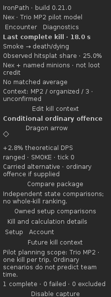
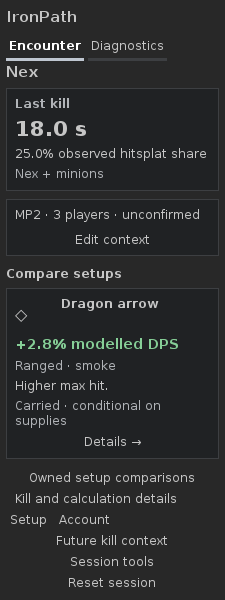
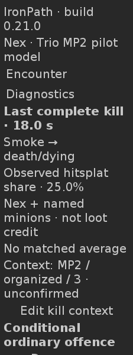
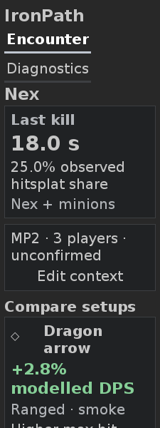
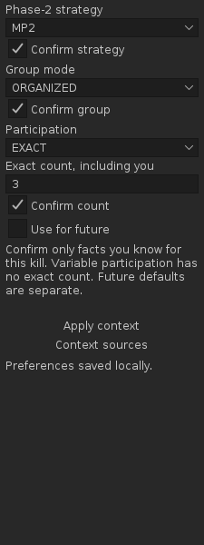
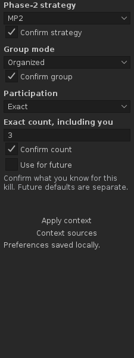
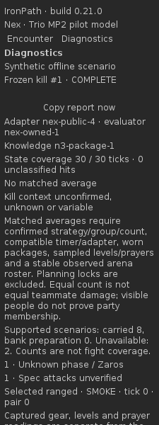
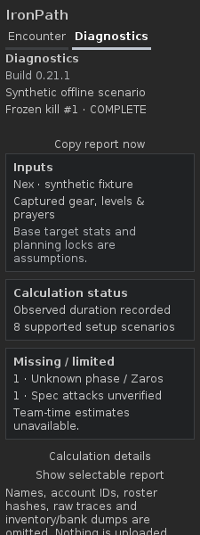

# UI1 native refinement — issue #44

18 October 2026. Development build **0.21.1**, a separate follow-up to corrected
CTX1 PR #43 at `2fe53429526a2e43a6489e48af3cfba596925b03`. That dependency was open
when implementation started; this PR targets its branch and does not merge it.
Main's later PR #45 / 0.22.1 N3 declared-plan work is separate. Reconcile the
branches after CTX1 lands; no new N3 result sections are added here.

The subsequent [PR #46 visual review](ui1-46-visual-review.md) supersedes this
iteration's appearance and diamond placeholders, with genuine item sprites,
compact grouping and the Diagnostics disclosure correction. The images/results
below retain their original `997f923` delivery scope.

## Implemented behavior

The native 225px Encounter now leads with Nex, a dark last-complete-kill card,
prominent observed duration and explicitly scoped hitsplat share. One compact
context summary and Edit follow. Unknown, mass, variable and unconfirmed context
remain visible; the optional editor retains independent fields, confirmation,
provenance, explicit Apply and separate future defaults. An inspected older
record is labeled Selected kill, rather than implying it is the latest kill.

**Compare setups** shows separated changed-item/package cards with ItemManager
sprite wells, a supported modelled DPS benefit, role/phase, a short reason derived
from the existing comparison, and Details. Carried/supply, bank stock/packing,
partial-search and healing limitations stay beside affected claims. The first
two deterministic cards appear initially; More comparisons exposes all further
positive cards. Selection/order/deduplication do not change, and zero/negative/
unavailable alternatives remain in Owned setup comparisons. There is no
cross-state percentage ranking or filler quota.

Diagnostics groups Inputs, Calculation status and Missing / limited using actual
support. Build is directly visible; Calculation details retains model versions,
ticks, coverage, matching exclusions and methodological scope. Copy report stays
near the top. Its allowlisted immutable selection, explicit copy, fallback text,
caret/selection/scroll and stale-action guards are preserved. Setup, Account,
future defaults, comparisons, kill details and Reset remain secondary controls;
capture controls/counts are under Session tools.

No formulas, capture semantics, persisted data, automatic spec attribution,
acquisition estimates or team-time claims change. DESIGN and TASKS continue to
govern actual-to-owned versus owned-to-upgrade value, relevant resources/costs
and validated N4 ambitions. This refinement completes the visual goal of UI1.

## Actual before/after screenshots

Both versions use **the same DEV1 synthetic fixture**, RuneLiteLAF and DejaVu Sans
12/20. The before images were generated from exact corrected CTX1 `2fe5342` before
editing. The after images are native Swing output from this implementation;
the delivery PR records its exact commit and current CI artifact. Each image
below is an actual **225 × 600 JViewport**, including normal scroll clipping at
viewport edges. Full-height renders in the artifact are separately checked for
unintended clipping. These are neither concept images nor real-client captures.

**The diamond sprite wells are offline placeholders.** Production still calls
ItemManager for actual item sprites, with the existing stale-image guard. No
item imagery, gameplay observations or stronger benefit was fabricated.

| Encounter, font 12 — before | Encounter, font 12 — after |
|---|---|
|  |  |

| Encounter, font 20 — before | Encounter, font 20 — after |
|---|---|
|  |  |

| Context fields, font 12 — before | Context fields, font 12 — after |
|---|---|
|  |  |

| Diagnostics, font 12 — before | Diagnostics, font 12 — after |
|---|---|
|  |  |

Enlarged-font [context before](images/ui1-44/before-context-20.png),
[context after](images/ui1-44/after-context-20.png),
[Diagnostics before](images/ui1-44/before-diagnostics-20.png) and
[Diagnostics after](images/ui1-44/after-diagnostics-20.png) retain the same viewport
size. Only these selected review images are committed; routine generated reports
and all other captures stay in build/review and CI artifacts.

## Visual comparison against the references

Personally inspected the existing [primary Encounter/Diagnostics concept](https://github.com/PetterHL/ironpath/blob/46fbb903defbe3eacf2512bc7c51d9ac614ca42b/docs/ui-references/ui1-44/encounter-diagnostics-reference.png)
and [secondary card reference](https://github.com/PetterHL/ironpath/blob/46fbb903defbe3eacf2512bc7c51d9ac614ca42b/docs/ui-references/ui1-44/killimpact-original-reference.png).
The implemented selected-tab underline, dark separated surfaces, bold result,
item/name/green-benefit/details hierarchy and restrained secondary text follow
their presentation. Native fonts remain readable; the text no longer competes
with repeated engine explanations. Geometry checks supplement this inspection.

Material adaptations to the concepts:

- One 225px sidebar; the two illustrated tab states are never simultaneous columns.
  At font 20 the full tab labels stack, rather than eliding or shrinking text.
- Two observed results stack in one card. Food, deaths and time-saved examples are
  omitted because the implementation does not support those measurements/claims.
- Context is explicitly added between the result and comparisons. Compare setups
  fits one line at font 20. The first supported benefit and its phase scope fit
  the initial 600px viewport; lower reasons/actions scroll naturally at that size.
- The single useful arrow change is shown without decorative extra cards or a
  global rank. It names Dragon arrow, with +2.8% modelled DPS and ranged/smoke scope.
- Copy report precedes the Diagnostics groups so it remains reachable in the
  initial screenful at both fonts. Longer status/gaps/detail content scrolls.
  Optional editor fields/Apply also use ordinary scrolling at font 20.
- The Nex heading uses text. Actual live item images retain ItemManager; the
  offline placeholders are disclosed above. No RuneLite toolbar or boss art is
  recreated, and no runtime Save screenshot feature is introduced.

## Verification and open acceptance

Use JDK **11.0.32.1**, Gradle **8.10** and pinned RuneLite client/API **1.13.2**.
Source the prepared environment activation described in DEVELOPMENT; retain its
HTTPS proxy and CA trust. The baseline command passed all 12 scenarios before
implementation. Final delivery commands:

```sh
./gradlew -PruneLiteVersion=1.13.2 test build offlineReview --no-daemon
./gradlew test build --no-daemon
./gradlew dependencyInsight --dependency net.runelite:client --configuration compileClasspath --no-daemon
git diff --check
```

Final pinned validation passed: **310 tests, zero failures; 12 DEV1 scenarios,
793 checks, zero failures; 164 PNGs**. The normal build passed with the same
outputs up to date. Dependency inspection resolved `latest.release` to **1.13.2**;
this is not evidence for a newer RuneLite release. DejaVu Sans was verified by the
harness. Fontconfig printed a non-writable-cache warning; no check or render was
skipped. `git diff --check` and the edited documentation's relative links pass.

Focused regression coverage exercises selected tabs, disclosure across refresh,
opening a further card, preserving its selected pair through Diagnostics/Back,
retaining all alternatives and reaching detailed calculation scope. DEV1 extends
the same harness with pending/no-positive Encounter states and context/comparison
viewports. The initial viewport check verifies duration, Edit, the first supported
benefit and its phase scope at both fonts. All original capture, arithmetic,
unknown-input, banking/reload, identity/reset and frozen-history cases remain.
CTX1's active-encounter copy/fallback/Back and revision regressions are preserved.

An intermediate viewport assertion caught the first comparison's phase scope
falling below 600px at font 20. Shortening the hitsplat target label fixed it;
the claim still explicitly identifies observed hitsplats and Nex/minions. A
width-dependent native BoxLayout cache also needed invalidation on the padded
card surfaces so longer unknown context wraps without losing its last line.

Real-client event mappings, actual sprites, OS focus/keyboard/scroll/DPI and
clipboard behavior, bank/reload retesting and player usefulness remain **open**.
Gameplay is deferred at Petter's request. Screenshot review can proceed without
a Nex kill. Synthetic tests are not live acceptance, Plugin Hub approval or
authorization to merge/publish this feature or its dependency.
